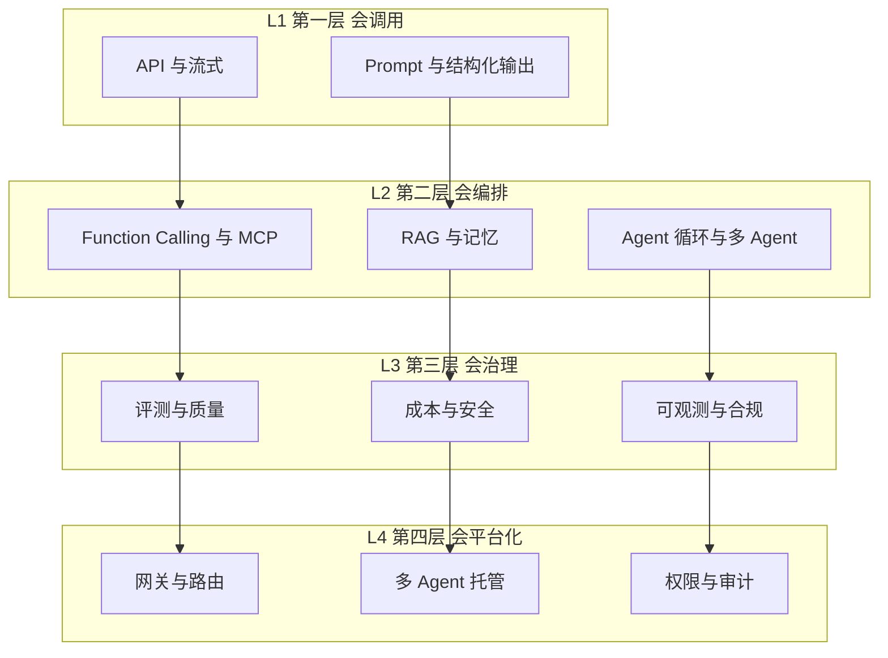

## AGT-120：从 POC 到生产的落地 checklist 是什么？Agent 开发能力体系如何收束？
**答**：
- 落地 checklist 分层过：质量（评测集通过率）、安全（注入/PII/权限/红队）、成本（账单与预算告警）、可观测（trace/审计/看板）、体验（TTFT/流式/降级）、合规（数据驻留/保留策略）。
- POC 与生产的本质差异：POC 验证「模型能不能做」，生产要保证「系统稳定地做」——失败路径、预算、权限、监控一个不能少。
- 能力体系四层收束：会调用（API/流式/结构化输出）→ 会编排（工具/RAG/Agent 循环）→ 会治理（评测/成本/安全）→ 会平台化（网关/托管/权限审计）。
- 面试收尾话术：前端工程师的优势在交互与工程质量——恰是 Agent 落地最缺的两块；核心不是背框架，而是对具体场景做「模型能力-工程约束-用户体验」的三方权衡。



```typescript
// 上线 checklist 自动检查脚本（节选）
const CHECKLIST: { area: string; check: () => Promise<boolean>; hint: string }[] = [
  { area: '质量',   check: async () => (await runEvalSuite('smoke')).passRate >= 0.9, hint: '评测集通过率 >= 90%' },
  { area: '安全',   check: async () => { await runRedTeam(); return true; },          hint: '红队用例零容忍通过' },
  { area: '安全',   check: async () => piiScanEnabled(),                              hint: '输入脱敏与输出过滤已启用' },
  { area: '成本',   check: async () => budgetAlertConfigured(),                       hint: '每日预算与超额告警已配置' },
  { area: '可观测', check: async () => traceSamplingOk(),                             hint: 'trace 采样与审计日志落库正常' },
  { area: '体验',   check: async () => (await metrics.percentile('ttft_ms', 0.95)) < 3000, hint: 'TTFT P95 小于 3s' },
];

export async function preflightCheck() {
  const failed: string[] = [];
  for (const c of CHECKLIST) {
    const ok = await c.check().catch(() => false);
    console.log(`${ok ? 'PASS' : 'FAIL'} [${c.area}] ${c.hint}`);
    if (!ok) failed.push(`${c.area}: ${c.hint}`);
  }
  if (failed.length) throw new Error(`未达上线标准：\n${failed.join('\n')}`);
}
```

---

## 二十二、协议与标准深入
