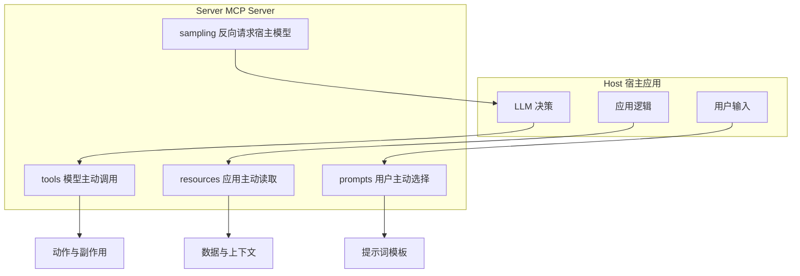

## AGT-121：MCP 的 resources / prompts / sampling 三大能力与 tools 有什么区别？各自适用什么场景？
**答**：
- `tools` 是模型可主动调用的动作（模型主导，触发执行）；`resources` 是应用可读取的数据源（应用主导，被动拉取，类似 GET 文件）；`prompts` 是用户主动选择的提示词模板（用户主导，类似斜杠命令）。
- 三者控制权不同：tools 由 LLM 决定调用，resources 由宿主应用决定何时注入，prompts 由用户决定是否使用——这是设计 MCP server 时的核心分界。
- `sampling` 是反向能力：MCP server 请求宿主的 LLM 帮它推理（server 借用宿主模型），模型选择权、审批权、成本都在宿主手里。
- 高频误区：把所有东西都塞进 tools——静态文档应做成 resources（可列表可预览），固定工作流应做成 prompts（用户可控），只有「模型需要决策后执行的动作」才做 tools。



```typescript
// MCP server 同时暴露 tools / resources / prompts / sampling 四类能力
import { McpServer } from '@modelcontextprotocol/sdk/server/mcp.js';
import { StdioServerTransport } from '@modelcontextprotocol/sdk/server/stdio.js';
import { z } from 'zod';

const server = new McpServer({ name: 'doc-server', version: '1.0.0' });

// 1. tools：模型需要「决策后执行」的动作，可能有副作用
server.tool(
  'create_ticket',
  '创建工单，有副作用，模型在用户明确要求时调用',
  { title: z.string(), priority: z.enum(['low', 'high']) },
  async ({ title, priority }) => ({ content: [{ type: 'text', text: `ticket-${Date.now()}` }] }),
);

// 2. resources：静态数据，应用决定是否拉取，无副作用，可被用户预览
server.resource('doc', 'docs://api/auth.md', async () => ({
  contents: [{ uri: 'docs://api/auth.md', mimeType: 'text/markdown', text: '# 鉴权文档...' }],
}));

// 3. prompts：用户通过斜杠命令选择，展开为固定模板注入
server.prompt('review-pr', { diff: z.string() }, ({ diff }) => ({
  messages: [{ role: 'user', content: { type: 'text', text: `请审查以下 diff：\n${diff}` } }],
}));

// 4. sampling：server 反过来请求宿主的 LLM 做一次推理（宿主可审批、可拒绝）
async function summarizeWithHostModel(text: string) {
  const result = await server.server.createMessage({
    messages: [{ role: 'user', content: { type: 'text', text } }],
    maxTokens: 500,
  });
  return result.content.type === 'text' ? result.content.text : '';
}

await server.connect(new StdioServerTransport());
```
