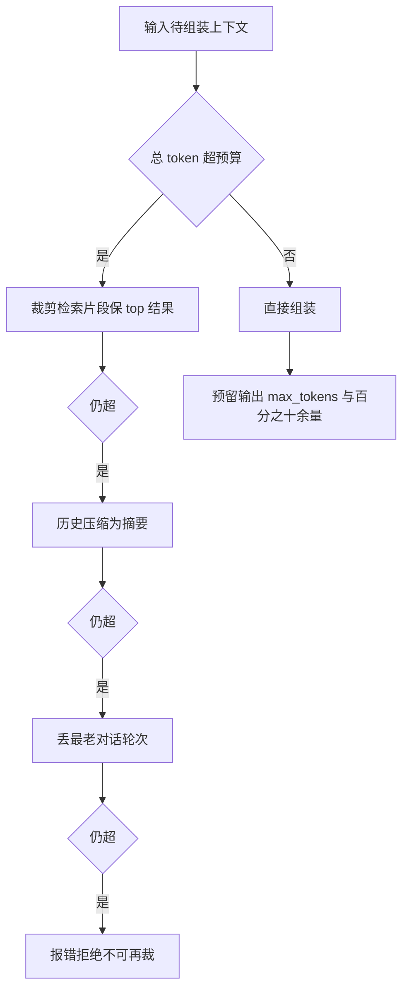

## AGT-128：上下文窗口的预算分配器怎么设计（系统/记忆/检索/对话各占多少）？
**答**：
- 核心思想：把模型上下文窗口当成显存做「分区预算」——固定配额（系统提示、工具定义）+ 弹性配额（检索片段、记忆摘要、对话历史）+ 安全余量（输出 max_tokens 与误差缓冲）。
- 分配比例随任务类型变化：RAG 问答检索占大头，长对话助手历史占大头，编码 Agent 工具定义占大头——分配器接受策略配置而非写死比例。
- 预算超限时的裁剪顺序要可配置：一般先裁检索片段（保留 top 结果）、再压缩历史（转摘要）、最后动系统提示（红线）。
- 高频考点：预算单位必须用 token 而不是字符，且要按「各模型的 tokenizer」估算，预留 10% 误差。



```typescript
// 上下文预算分配器
type Part = 'system' | 'tools' | 'memory' | 'retrieval' | 'history' | 'input';

const PRESETS: Record<string, Partial<Record<Part, number>>> = {
  rag:    { system: 0.1, tools: 0.05, memory: 0.05, retrieval: 0.45, history: 0.25, input: 0.10 },
  chat:   { system: 0.08, tools: 0.02, memory: 0.15, retrieval: 0.10, history: 0.55, input: 0.10 },
  coding: { system: 0.12, tools: 0.30, memory: 0.08, retrieval: 0.15, history: 0.25, input: 0.10 },
};

export class ContextBudgeter {
  constructor(private windowTokens: number, private reserveOutput = 4096, private estimate: (s: string) => number) {}

  private budget(preset: string) {
    const usable = this.windowTokens - this.reserveOutput;
    const ratio = { ...PRESETS.chat, ...PRESETS[preset] };
    const out = {} as Record<Part, number>;
    for (const [k, v] of Object.entries(ratio)) out[k as Part] = Math.floor(usable * v!);
    return out;
  }

  fit(parts: Record<Part, string[]>, preset = 'chat'): string[] {
    const limit = this.budget(preset);
    const used: Partial<Record<Part, number>> = {};
    const kept: Partial<Record<Part, string[]>> = {};
    // 顺序裁剪：先保 system/tools/input（红线），弹性区从低优先级开始塞
    const order: Part[] = ['system', 'tools', 'input', 'memory', 'retrieval', 'history'];
    for (const part of order) {
      kept[part] = [];
      used[part] = 0;
      for (const item of [...(parts[part] ?? [])].reverse()) { // 弹性区保留最新的
        const t = this.estimate(item);
        if (used[part]! + t > limit[part]) continue;
        used[part]! += t;
        kept[part]!.unshift(item);
      }
    }
    return order.flatMap((p) => kept[p] ?? []);
  }
}
```
