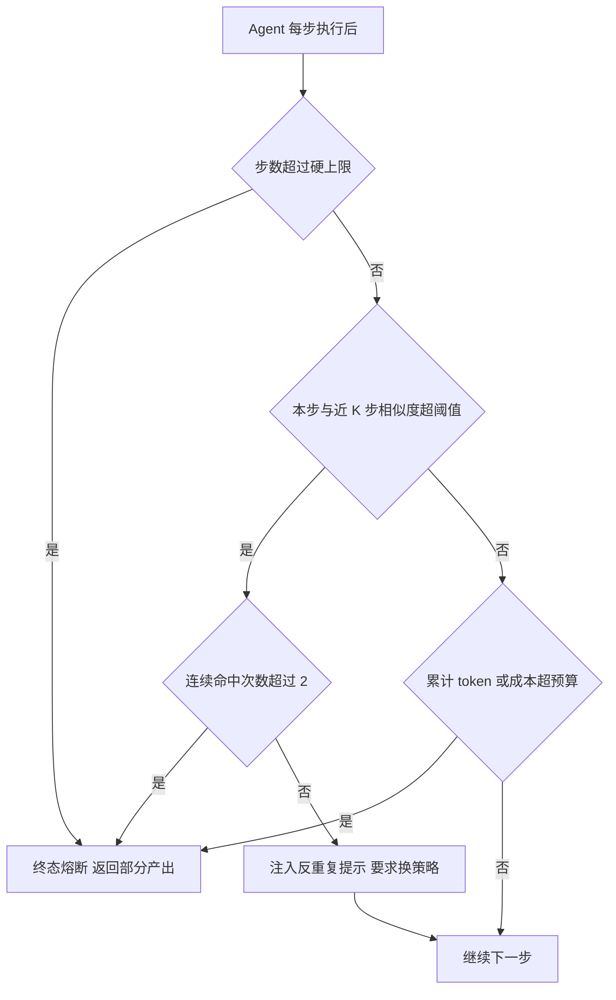

## AGT-136：Agent 无限循环怎么检测与熔断？步数、相似度、预算三重熔断如何设计？
**答**：
- Agent 死循环的常见形态：同一工具反复调用参数几乎不变、两次回复内容雷同、「我需要更多信息」来回拉扯——纯步数上限只能防失控，防不了「在预算内空转」。
- 三重熔断：步数熔断（硬上限）、相似度熔断（连续 K 步的响应/工具参数 embedding 相似度超阈值即判定打转）、预算熔断（token/美元累计超限）。
- 熔断后的行为要分级：可恢复（追加一条「检测到重复，请改变策略」注入新尝试）与终态（终止并上报，把已完成的部分产出返回给用户）。
- 相似度用便宜方案就够：工具调用签名的字符串编辑距离或 SimHash，不必每步都调 embedding。



```typescript
// 三重熔断器
interface Step { toolName: string; args: unknown; reply: string; tokens: number; }

function simHash(s: string): string {
  return [...s.matchAll(/\w+/g)].map((w) => w[0]).join('').slice(0, 64).toLowerCase(); // 简化指纹，生产可用 SimHash
}

export class LoopBreaker {
  private steps: Step[] = [];
  private repeatHits = 0;
  private spentTokens = 0;

  constructor(
    private maxSteps = 25,
    private maxTokens = 100_000,
    private simThreshold = 0.92,
    private fingerprint = (s: Step) => `${s.toolName}#${simHash(JSON.stringify(s.args))}`,
  ) {}

  check(step: Step): 'continue' | 'nudge' | 'abort' {
    this.steps.push(step);
    this.spentTokens += step.tokens;
    if (this.steps.length > this.maxSteps) return 'abort';                      // 熔断一：步数
    if (this.spentTokens > this.maxTokens) return 'abort';                      // 熔断三：预算

    const fp = this.fingerprint(step);                                          // 熔断二：相似度
    const recent = this.steps.slice(-5, -1).map(this.fingerprint.bind(this));
    const nearDup = recent.some((r) => r === fp || this.editDist(r, fp) < 4);
    if (nearDup) {
      if (++this.repeatHits >= 3) return 'abort';
      return 'nudge'; // 可恢复：注入一条反重复指令再试
    }
    this.repeatHits = 0;
    return 'continue';
  }

  nudgeMessage = '检测到你在重复相近的操作。请先总结当前进展，然后换一种策略或直接给出结论。';

  private editDist(a: string, b: string): number {
    const dp = Array.from({ length: a.length + 1 }, (_, i) => [i, ...Array(b.length).fill(0)]);
    for (let j = 0; j <= b.length; j++) dp[0][j] = j;
    for (let i = 1; i <= a.length; i++)
      for (let j = 1; j <= b.length; j++)
        dp[i][j] = Math.min(dp[i - 1][j] + 1, dp[i][j - 1] + 1, dp[i - 1][j - 1] + (a[i - 1] === b[j - 1] ? 0 : 1));
    return dp[a.length][b.length];
  }
}
```
