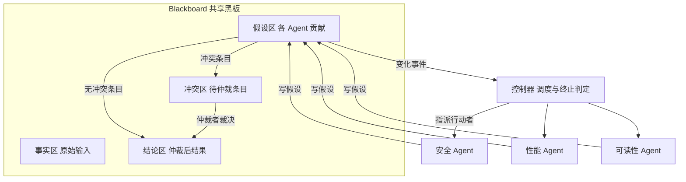

## AGT-155：黑板模式（Blackboard）的多 Agent 协作怎么实现？
**答**：
- 模式本质：多个 Agent 不直接对话，而是读写一块「共享黑板」（结构化状态空间），各自订阅自己关心的条目变化并贡献部分解——解耦、可插拔、天然支持异构 Agent。
- 组成三件：黑板数据结构（分区：事实/假设/结论/冲突）、知识源（各 Agent 的触发条件「我何时行动」与行动「我做什么」）、控制器（决定下一个行动者与终止时机）。
- 与流水线模式对比：流水线是固定顺序，黑板是条件触发、顺序由状态驱动，适合「多视角分析同一问题」（如多维度评审一个方案）。
- 工程要点：黑板条目要带版本与作者，写入冲突用「追加假设 + 控制器仲裁」而不是覆盖；每个 Agent 行动后写 audit。



```typescript
// 黑板模式实现：共享状态 + 条件触发 + 控制器
interface Entry<T = unknown> { id: string; zone: 'fact' | 'hypothesis' | 'conclusion' | 'conflict';
  author: string; content: T; version: number; ts: number; }

type KnowledgeSource = {
  name: string;
  when: (bb: Blackboard) => boolean;                       // 触发条件：黑板上出现我关心的状态
  act: (bb: Blackboard) => Promise<void>;                  // 行动：写回黑板
};

export class Blackboard {
  private entries: Entry[] = [];
  private version = 0;
  write(zone: Entry['zone'], author: string, content: unknown) {
    const e: Entry = { id: crypto.randomUUID(), zone, author, content, version: ++this.version, ts: Date.now() };
    this.entries.push(e);
    this.listeners.forEach((l) => l(e));
    return e;
  }
  read(zone?: Entry['zone']) { return zone ? this.entries.filter((e) => e.zone === zone) : [...this.entries]; }
  private listeners: ((e: Entry) => void)[] = [];
  subscribe(l: (e: Entry) => void) { this.listeners.push(l); }
}

export async function runBlackboard(bb: Blackboard, sources: KnowledgeSource[], maxRounds = 10) {
  for (let round = 0; round < maxRounds; round++) {
    const ready = sources.filter((s) => s.when(bb));
    if (!ready.length) break;                               // 没有知识源可行动 → 收敛
    await Promise.all(ready.map((s) => s.act(bb).catch((e) =>
      bb.write('conflict', s.name, { error: (e as Error).message })))); // 并行行动，异常入冲突区
    if (bb.read('conclusion').length > 0 && bb.read('conflict').length === 0) break; // 有结论且无冲突 → 终止
  }
  return bb.read('conclusion');
}

// 示例知识源：性能 Agent 检测到事实区有「方案」就评审
const perfAgent: KnowledgeSource = {
  name: 'perf-reviewer',
  when: (bb) => bb.read('fact').some((f) => (f.content as any).type === 'proposal')
    && !bb.read('hypothesis').some((h) => h.author === 'perf-reviewer'),
  act: async (bb) => { bb.write('hypothesis', 'perf-reviewer', await reviewForPerf(bb.read('fact'))); },
};
async function reviewForPerf(facts: Entry[]): Promise<string> { void facts; return '首屏渲染可并发化，预计提升 40%'; }
```
