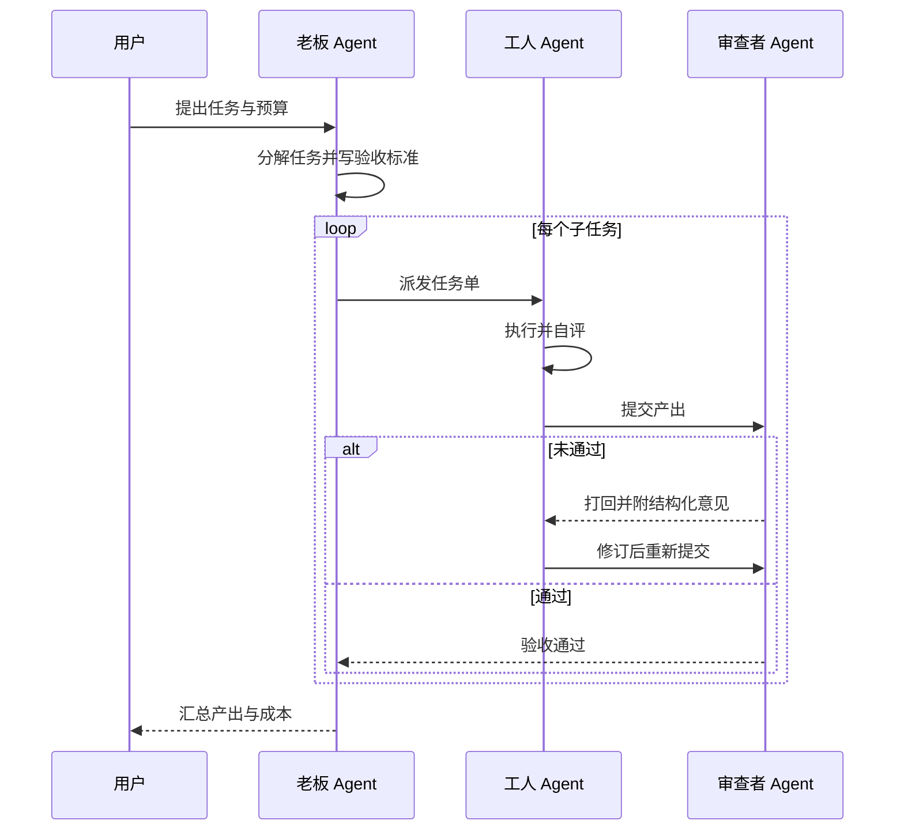

## AGT-156：Agent 团队的角色协议（老板/工人/审查者）怎么设计？
**答**：
- 角色分工：老板（Orchestrator）负责任务分解、分派、验收与终止，不亲自干活；工人（Worker）只接单一职责子任务，输出带自评；审查者（Reviewer）独立校验工人产出（不接受工人的自评作为依据），决定通过或打回。
- 协议要点：任务单（ticket）承载一切——id、验收标准（DoD）、输入上下文、预算；打回必须带结构化意见（哪条验收标准未过），工人据此修订而不是凭感觉重做。
- 终止与升级：同一任务被打回超过 N 次（如 2 次），升级给老板改写任务或换工人——防止「工人↔审查者」互相拉锯烧 token。
- 高频考点：审查者必须用不同的模型或至少不同的 prompt 视角，同一视角自审等于没审。



```typescript
// 老板/工人/审查者 角色协议
import { z } from 'zod';

const Ticket = z.object({
  id: z.string(), goal: z.string(),
  dod: z.array(z.string()),                     // 验收标准 Definition of Done
  context: z.string(), budgetUsd: z.number(),
  revision: z.number().default(0),
});
type Ticket = z.infer<typeof Ticket>;

const ReviewResult = z.object({ pass: z.boolean(), failedDod: z.array(z.string()).default([]), comments: z.string() });

export class Supervisor {
  constructor(private worker: Agent, private reviewer: Agent, private maxRevisions = 2) {}

  async dispatch(ticket: Ticket): Promise<{ output: string; revisions: number }> {
    while (ticket.revision <= this.maxRevisions) {
      const work = await this.worker.run({
        system: `你是工人。只完成任务单，输出前按验收标准自评。\n任务单：${JSON.stringify(ticket)}`,
      });
      // 审查者独立校验，只看产出与验收标准，不看工人自评
      const reviewRaw = await this.reviewer.run({
        system: `你是审查者。逐条核对验收标准，输出 JSON：{ pass, failedDod, comments }。\n标准：${JSON.stringify(ticket.dod)}`,
        user: work,
      });
      const review = ReviewResult.parse(JSON.parse(reviewRaw));
      if (review.pass) return { output: work, revisions: ticket.revision };

      ticket.revision++;
      if (ticket.revision > this.maxRevisions) {
        return { output: `[升级人工] 任务 ${ticket.id} 打回 ${this.maxRevisions} 次未过：${review.comments}`, revisions: ticket.revision };
      }
      ticket.context += `\n[审查意见] 未达标项：${review.failedDod.join('、')}。${review.comments}`; // 结构化打回
    }
    throw new Error('unreachable');
  }
}

interface Agent { run: (m: { system: string; user?: string }) => Promise<string>; }
```
