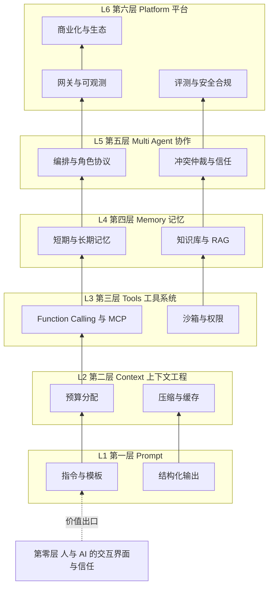

## AGT-200：AI 产品经理 × 前端协作模式如何运转？Agent 知识体系如何按六层收束？
**答**：
- 协作模式的变化：PM 的产出从「页面流程图」演进为「意图流 + 任务失败路径」——定义用户意图的覆盖范围、AI 不确定时的降级路径、HITL 介入时机；前端把这些翻译成「状态机 + 交互契约」，而不是静态页面。
- 三个协作锚点文档：能力边界表（AI 能做什么/不能做什么/置信区间——PM 定范围、工程定可实现性）、评测共同负责制（PM 提供真实场景用例，工程建评测管线，上线判据双方签字）、反馈回路（PM 分析负反馈聚类转需求，工程转评测用例）。
- 六层知识体系收束：prompt（单次交互质量）→ context（上下文工程，AGT-128 起）→ tools（能力供给，MCP/沙箱）→ memory（跨会话状态）→ multi-agent（协作与治理）→ platform（网关/评测/合规/商业化）——下层不稳上层必塌，诊断问题时自下而上排查，建设能力时自下而上演进。
- 收束心法：前端工程师的不可替代性在「第 0 层」——人与 AI 的交互界面与信任构建，这是所有上层的价值出口。



```typescript
// 六层体系的自上而下诊断器：回答异常时自下而上定位
type Layer = 'platform' | 'multi_agent' | 'memory' | 'tools' | 'context' | 'prompt';

export async function diagnoseBadAnswer(symptom: {
  wrongFacts?: boolean; toolFailed?: boolean; contextLost?: boolean;
  coordinationIssue?: boolean; latencyOrCostAnomaly?: boolean;
}): Promise<{ rootLayer: Layer; checks: string[] }> {
  // 自下而上：先排除基础设施，再排查上层
  if (symptom.latencyOrCostAnomaly) {
    return { rootLayer: 'platform', checks: ['网关限流与路由日志', '模型降级是否触发', '缓存命中率是否异常'] };
  }
  if (symptom.coordinationIssue) {
    return { rootLayer: 'multi_agent', checks: ['跨 Agent trace 串联（AGT-161）', '冲突仲裁记录', '角色协议的打回历史'] };
  }
  if (symptom.wrongFacts && !symptom.toolFailed) {
    return { rootLayer: 'memory', checks: ['知识库新鲜度（AGT-145）', '检索权限过滤是否剪掉了正确文档（AGT-142）', 'embedding 迁移是否混空间（AGT-144）'] };
  }
  if (symptom.toolFailed) {
    return { rootLayer: 'tools', checks: ['工具执行 trace（AGT-140）', '沙箱与超时配置', 'MCP 信任分级（AGT-123）'] };
  }
  if (symptom.contextLost) {
    return { rootLayer: 'context', checks: ['预算分配是否裁掉了关键片段（AGT-128）', '摘要压缩是否丢信息（AGT-129）', '前缀稳定性与缓存命中（AGT-130）'] };
  }
  return { rootLayer: 'prompt', checks: ['指令是否被注入覆盖（AGT-050/134）', 'few-shot 示例是否误导', '输出格式约束是否过紧（AGT-048）'] };
}
```
