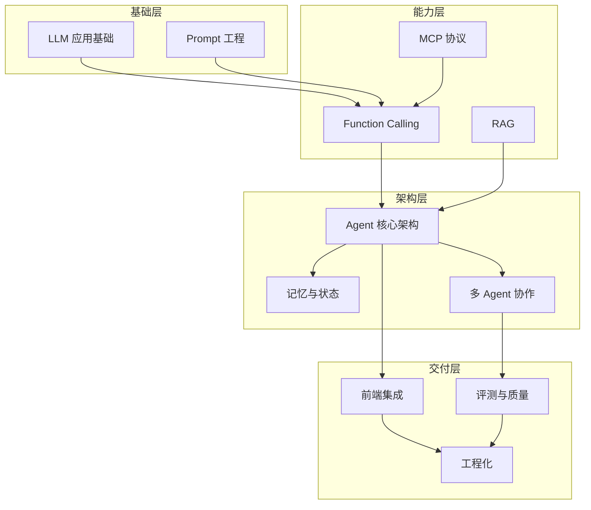

# 前端面试题库：Agent 开发（LLM 应用 / Agent / RAG / MCP）

本文件收录面向前端工程师的 LLM Agent 开发面试题，覆盖 LLM 应用基础（Chat Completions API、流式 SSE、上下文管理）、Prompt 工程、Function Calling / Tool Use 闭环、Agent 核心架构（ReAct）、RAG 检索增强、MCP 协议、前端对话 UI 集成、记忆与状态、多 Agent 协作、评测与工程化。代码以 TypeScript 为主，直接用 fetch 调用 OpenAI 兼容接口，不绑定特定 SDK。为控制篇幅，文中 `fetchCompletion`、`llmComplete`、`parseSSE`、`safeJsonParse` 等辅助函数的签名以首次出现处为准，后文直接复用。

## 目录

- 一、LLM 应用基础（AGT-001 ~ AGT-007）
- 二、Prompt 工程（AGT-008 ~ AGT-012）
- 三、Function Calling 与 Tool Use（AGT-013 ~ AGT-017）
- 四、Agent 核心架构（AGT-018 ~ AGT-021）
- 五、RAG 检索增强（AGT-022 ~ AGT-026）
- 六、MCP 协议（AGT-027 ~ AGT-029）
- 七、前端集成（AGT-030 ~ AGT-035）
- 八、记忆与状态（AGT-036）
- 九、多 Agent 协作（AGT-037 ~ AGT-038）
- 十、评测与质量（AGT-039）
- 十一、工程化（AGT-040）
- 十二、流式与传输深水区（AGT-041 ~ AGT-047）
- 十三、Prompt 工程进阶（AGT-048 ~ AGT-054）
- 十四、工具系统深入（AGT-055 ~ AGT-062）
- 十五、Agent 架构进阶（AGT-063 ~ AGT-070）
- 十六、RAG 进阶（AGT-071 ~ AGT-077）
- 十七、模型与推理层（AGT-078 ~ AGT-083）
- 十八、前端 × AI 交互设计（AGT-084 ~ AGT-090）
- 十九、评测与质量工程（AGT-091 ~ AGT-096）
- 二十、工程与安全（AGT-097 ~ AGT-104）
- 二十一、综合实战（AGT-105 ~ AGT-120）
- 二十二、协议与标准深入（AGT-121 ~ AGT-127）
- 二十三、上下文工程（AGT-128 ~ AGT-134）
- 二十四、Agent 可靠性工程（AGT-135 ~ AGT-141）
- 二十五、检索与知识管理进阶（AGT-142 ~ AGT-147）
- 二十六、Agent UI 工程深水区（AGT-148 ~ AGT-154）
- 二十七、多 Agent 协作进阶（AGT-155 ~ AGT-161）
- 二十八、领域 Agent 设计模式（AGT-162 ~ AGT-168）
- 二十九、数据与训练视角（AGT-169 ~ AGT-174）
- 三十、平台与生态（AGT-175 ~ AGT-181）
- 三十一、综合与前瞻（AGT-182 ~ AGT-200）

---

## 一、LLM 应用基础

