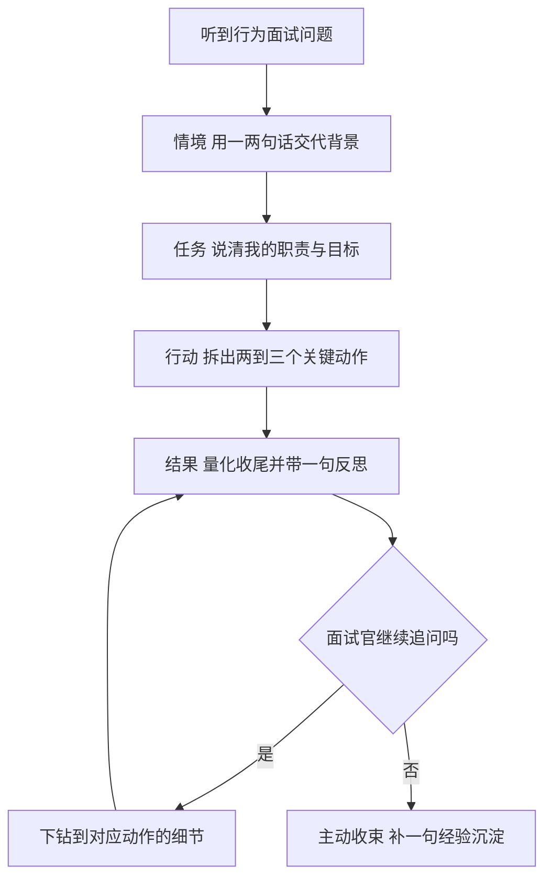

## SOFT-019：STAR 法完整拆解：怎么用才不生硬？

**答**：
- STAR 是行为题的底层结构：Situation 背景、Task 任务、Action 行动、Result 结果；行为面试官用过去行为预测未来表现，所以追问永远往"你具体做了什么"上钻。
- 生硬用法是背四段，正确用法是**加权**：S/T 合起来不超过两成篇幅，Action 占五成，Result 占三成。
- Action 要拆成 2~3 个具体动作，每个动作能独立扛住"为什么这么做"的追问。
- Result 必须量化，并补一句反思/沉淀，把故事升级为经验。
- 提前备 4~5 个素材故事（冲突、失败、跨团队、超预期交付、快速学习），一个故事应对多类问题。



```text
STAR 素材卡片模板（提前写好 4~5 张，每场面试前扫一遍）

【故事标签】冲突处理 / 项目延期救火 / 跨团队推动 / ……
S 背景：______（时间、团队、业务场景，两句内）
T 任务：我负责______，目标是______
A 行动：
  动作 1：______（为什么这么做：______）
  动作 2：______（为什么这么做：______）
  动作 3：______（为什么这么做：______）
R 结果：______（数字）+ 沉淀：______

【填好示例卡片：跨团队推动】
S：去年 Q3，公司要大促前统一三个事业部的埋点口径
T：我作为前端侧接口人，负责推动埋点 SDK 统一
A：1 摸底三个团队现有实现差异（为什么：先量化问题才能立项）
   2 写兼容层让新旧 SDK 并行一个迭代（为什么：降低迁移风险）
   3 拉三方周会同步进度并出迁移文档（为什么：跨团队靠文档不靠口头）
R：大促前完成统一，数据口径冲突工单从每周 10+ 降到 0；
   沉淀：跨团队的事要"先给对方算收益，再谈配合"
```
