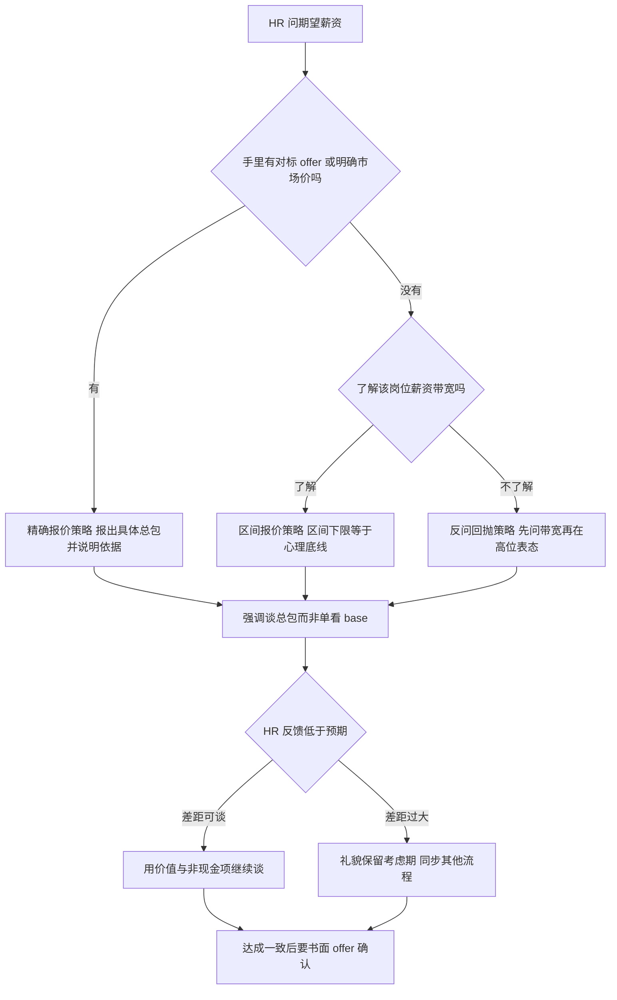

## SOFT-050：被问期望薪资时，报价、区间、反问三种策略怎么选？

**答**：
- 三种策略：**精确报价**（有对标筹码时）、**区间报价**（常规稳妥）、**反问回抛**（信息不足时）。
- 精确报价的前提：手里有对标 offer 或明确知道自己的市场价——报具体数字显得笃定，且锚定效应强。
- 区间报价的技巧：区间下限 = 你的心理底线，说"18~22"时你的真实目标是 20，不是 18。
- 反问回抛："想先了解下这个岗位的薪资带宽大概是多少？"——如果对方给了范围，你就在范围内报高位。
- 永远谈**总包**：base + 月数 + 绩效 + 期权/股票 + 五险一金基数，base 低但总包高的结构要算完再判断。



```text
三种策略话术模板

【精确报价】
"我目前的总包是 XX，这次看机会的预期涨幅在 25% 左右，
期望总包是 XX（base X 个月 + 绩效），主要依据是
我手上有一个同量级岗位的 offer 和当前市场行情。"

【区间报价】
"我期望在 XX 到 XX 之间，具体可以根据岗位职责和
整体福利结构来聊。"（注意：下限 = 心理底线，报出去就收不回）

【反问回抛】
"想先了解下这个岗位的薪资带宽大概是怎样的？
我好判断双方的预期是否在同一区间。"
（对方给范围 → 在上四分之一位报价；对方反问你不放 →
退回区间策略，区间的下限守住底线）

【总包核算公式】
年总包 = base × 月数 + 绩效奖金预期值 + 股票/期权年化价值
       + （公积金缴存差额 × 12）
base 15k×13 和 16k×12 差不多，但公积金与加班费基数差异巨大。
```
