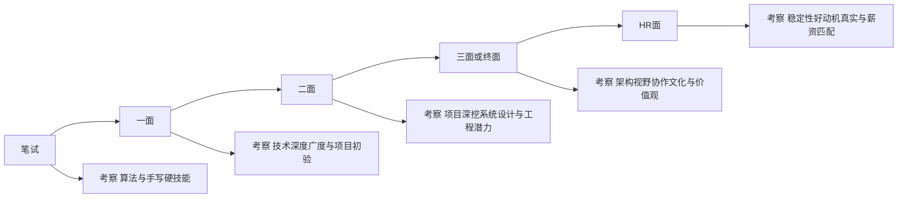

## SOFT-071：笔试到 HR 面各轮的考察侧重是什么？

**答**：
- 每轮筛的是不同维度：笔试筛硬技能下限，一面筛技术深度，二面筛工程与潜力，三面/终面筛视野与协作，HR 面筛稳定性与动机。
- 策略含义：**不同轮次准备重点不同**——一面背熟八股与手写，终面准备业务理解与规划类问题。
- 通过逻辑：每轮面试官给下一轮写反馈，所以**叙事一致性**贯穿全程（项目、离职原因、规划各轮口径必须统一）。
- 越往后越考"人"：终面没有标准答案，状态、价值观、与团队的化学反应权重上升。



```text
分轮备考清单（考前一天对照勾选）

笔试/机考前：
- [ ] 算法热身（本库 15 章 + 手写题 04 章高频 10 题）
- [ ] 熟悉考试环境（ACM 模式 vs 核心代码模式）

一面前：
- [ ] 自我介绍 60~90s 定稿并录音练习
- [ ] 简历上每个技术词的八股过一遍（写了就会被问）
- [ ] 项目 90 秒版本 + 追问预案

二面前：
- [ ] 项目深挖：亮点三层 + 挑战 + 选型（SOFT-011~015）
- [ ] 系统设计骨架过一遍（SOFT-032）
- [ ] 复盘一面被问住的问题，补齐

终面前：
- [ ] 公司业务功课：产品、新闻、技术博客（SOFT-065）
- [ ] 三五年规划、路线选择类问题定稿（SOFT-061~064）
- [ ] 反问问题按终面档位配置（SOFT-047）

HR 面前：
- [ ] 离职原因/空窗/跳槽频率口径统一（SOFT-024/053/067）
- [ ] 薪资策略三选一定好（SOFT-050）
- [ ] 背调联系人打招呼（SOFT-054）
```
