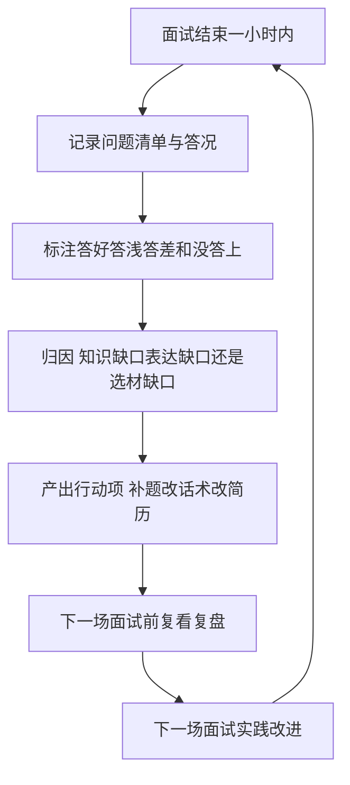

## SOFT-073：面试复盘怎么做？给一个每场必做的模板。

**答**：
- 复盘是整场求职季复利最高的动作：不复盘，面 20 家只是重复第一次；复盘，每场都在迭代。
- 黄金时间：结束后 1 小时内写完——记忆衰减很快，晚写一半细节丢失。
- 复盘三块：问题清单（原题 + 自己的答况）、亮点与失误归因、行动项（落到具体补什么）。
- 答况分四档：答好 / 答了但浅 / 答差 / 完全没答上——分别对应巩固、深化、修正、从零补。
- 复盘闭环：记录 → 归因 → 行动 → 下一场前复看 → 下一场实践——形成迭代循环。



```markdown
面试复盘模板（复制即用）

## 复盘：A 司前端二面（03-10，55 分钟，面试官 X 总）

### 一、问题清单
| # | 问题                          | 答况 | 备注               |
|---|-------------------------------|------|--------------------|
| 1 | 虚拟滚动实现细节              | 答好 | demo 经验加分      |
| 2 | 讲讲 diff 算法的优化策略      | 答浅 | 只答到双端比较     |
| 3 | 线上内存泄漏排查流程          | 答差 | 顺序混乱           |
| 4 | WebSocket 心跳重连实现        | 没答 | 完全空白           |

### 二、归因
- 第 2 题：知识缺口——longest-path 剪枝没复习到
- 第 3 题：表达缺口——知道但没结构，缺"复现→二分→验证"框架
- 第 4 题：知识缺口——从零补

### 三、行动项（落到人天）
- [ ] 用 SOFT-033 框架重答内存泄漏题并录音（0.5h）
- [ ] 补 WebSocket 心跳重连实现 + 手写一遍（2h）
- [ ] diff 算法优化策略对照本库 13 章补全（1h）

### 四、本场亮点（保留复用）
- 反问环节问了业务双层问题，面试官明显展开聊了 5 分钟

### 五、手感与状态
- 前半场语速偏快，后半场稳住了——下次开场刻意放慢
```
