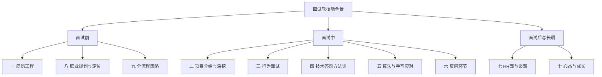

# 前端面试题库：面试软技能

> **定位**：技术面试的非代码环节全集——简历与项目包装、行为面试、技术答题方法论、算法与手写环节应对、反问环节、HR 面与谈薪、职业规划、全流程策略、心态与长期成长。这类题不考代码，考的是"把你会的东西卖出去"的能力；本题库中原本放代码块的位置，统一替换为**可直接套用的模板 / 话术骨架 / 结构块**（```text 或 ```markdown），每题一一对应， skeleton + 占位符 + 填好的示例。
>
> **使用方法**：面试前按章检索；每场面试后对照 SOFT-073 复盘模板落盘一次；改简历时对照 SOFT-010 自查清单过一遍。编号 SOFT-001 ~ SOFT-100，共 100 题。



## 目录

- 一、简历工程（SOFT-001 ~ SOFT-010）
- 二、项目介绍与深挖应对（SOFT-011 ~ SOFT-018）
- 三、行为面试（SOFT-019 ~ SOFT-027）
- 四、技术答题方法论（SOFT-028 ~ SOFT-036）
- 五、算法与手写环节应对（SOFT-037 ~ SOFT-041）
- 六、反问环节（SOFT-042 ~ SOFT-048）
- 七、HR 面与谈薪（SOFT-049 ~ SOFT-060）
- 八、职业规划与定位（SOFT-061 ~ SOFT-069）
- 九、面试全流程策略（SOFT-070 ~ SOFT-073）
- 复盘：A 司前端二面（SOFT-074 ~ SOFT-078）
- 十、心态与成长（SOFT-079 ~ SOFT-100）

---

## 一、简历工程

