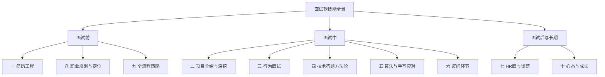

# 前端面试题库：面试软技能

> **定位**：技术面试的非代码环节全集——简历与项目包装、行为面试、技术答题方法论、算法与手写环节应对、反问环节、HR 面与谈薪、职业规划、全流程策略、心态与长期成长。这类题不考代码，考的是"把你会的东西卖出去"的能力；本题库中原本放代码块的位置，统一替换为**可直接套用的模板 / 话术骨架 / 结构块**（```text 或 ```markdown），每题一一对应， skeleton + 占位符 + 填好的示例。
>
> **使用方法**：面试前按章检索；每场面试后对照 SOFT-073 复盘模板落盘一次；改简历时对照 SOFT-010 自查清单过一遍。编号 SOFT-001 ~ SOFT-100，共 100 题。



## 目录

- 一、简历工程（SOFT-001 ~ SOFT-010）
- 二、项目介绍与深挖应对（SOFT-011 ~ SOFT-018）
- 三、行为面试（SOFT-019 ~ SOFT-027）
- 四、技术答题方法论（SOFT-028 ~ SOFT-036）
- 五、算法与手写环节应对（SOFT-037 ~ SOFT-041）
- 六、反问环节（SOFT-042 ~ SOFT-048）
- 七、HR 面与谈薪（SOFT-049 ~ SOFT-060）
- 八、职业规划与定位（SOFT-061 ~ SOFT-069）
- 九、面试全流程策略（SOFT-070 ~ SOFT-073）
- 复盘：A 司前端二面（SOFT-074 ~ SOFT-078）
- 十、心态与成长（SOFT-079 ~ SOFT-100）

---

## 一、简历工程


---

## 七波扩量（SOFT-501 ~ SOFT-900，共 400 张）

七波扩量按十大主题块推进，每块 40 张；每题含**可复用模板 + 反例**，笔试题为脚本模板类含评分点：

- 十一、技术方案汇报（SOFT-501 ~ SOFT-540）：文档黄金结构/ROI 量化/选型矩阵/预沟通/质疑接应/风险章节/非技术翻译/里程碑/技术债立项/迁移方案/降级沟通/决议跟踪/POC/调研报告/立项/版本留痕/备选方案/跨团队对齐/自检清单/被否动作/增量判断/评审人视角/写作反模式/紧急方案/分级视图/放量计划/ADR/依赖协调/demo 准备/收尾/创新落地/面试展示 + 笔试 8 张（骨架生成/选型矩阵/ROI/FAQ 清单/一页纸/风险台账/里程碑/预沟通计划）
- 十二、跨部门推动（SOFT-541 ~ SOFT-580）：利益对齐/自救升级/会议主持/接口契约/立项推动/资源冲突/向上求助/信任账户/反对派转化/共建治理/依赖台账/规范推广/跨部门复盘/异步协作/信息不对称/复盘/playbook/借力上级/破冰设计/翻译官/供应商/摩擦识别/破局显性化/节奏控制/边界管理/Kickoff/工具统一/小胜利/变更管理/信息等级/OKR 联动/关系修复/提案包装/IM 礼仪/意见整合/强制时机/策略帮忙/负荷管理/隐形成本/案例讲述 + 方法论收束（SOFT-580）
- 十三、向上管理与预期管理（SOFT-581 ~ SOFT-620）：范围谈判/坏消息 24h/承诺记账/绿灯汇报/期望校准/插队置换/要资源/异议四段/跨级分寸/风格适配/1:1 经营/误解消除/承诺核实/坏账处理/贡献可见/反馈获取/空降相处/反模式/信用体系/体系收束 + 进度可视/上限管理/想法池/看着办/落差补偿/背书/绩效对齐/减负消息/留白/配比/当众质疑/离职转岗/强势型/放养型/留痕监控/证据链/底线/多方冲突/负面评价/完整案例
- 十四、绩效周期应对（SOFT-621 ~ SOFT-660）：周期全景/自评写法/360/校准逻辑/面谈准备/连续 B 破局/申诉/低绩效 PIP/规则联动/时间管理/关系维护/强制分布/决策联动/日常评级/PIP 谈判/焦虑管理/申诉信/新人首年/口径争议/跨周期规划/向上反馈/模糊评价/隐性贡献/黑箱应对/意外事件/公开表达/长期博弈/提问策略/公开沟通/持续可见/方法论/互助平衡 + 笔试 8 张（证据链管理器/自评组装/面谈准备/PIP 追踪/对比表/周期日历/四象限/五维自检）
- 十五、晋升答辩逐环节（SOFT-661 ~ SOFT-700）：流程全景/自足性/时间分配/案例选择/问答攻防/贡献切割/数据口径/预答辩/临场管理/失败复盘/致命错误/特殊场景/证据附件包/表达/盲区应答/版本管理/评委功课/反问收尾/通过兑现/主线设计/紧张管理/时机四因素/故事化/不可替代性/时间规划/失败形象/冲突管理/通过逻辑/连环追问/减法/领导分工/方法论 + 笔试 8 张（主线生成/答案卡/mock 收集/时间轴/证据包/问答预算/失败归因/检查单）
- 十六、大厂层级软实力（SOFT-701 ~ SOFT-740）：层级图谱/P4-5 执行/P6 找事/P7 杠杆/文档转型/大小厂差异/文化适配/M 序列转型/双轨选择/层级语言/独立判断/横向补位/信息偏好/带新人/高层发言/跨层级协作/被看见/组织调整/信任建立/职业叙事 + 笔试 8 张（层级自评/杠杆盘点/时间画像/债台账/外溢度量/品牌评估/危机角色/叙事更新）
- 十七、P7-P8 视角（SOFT-741 ~ SOFT-780）：决策框架/问题定义/资源博弈/技术愿景/P7-TL 分工/虚拟团队/质量防线/P8 分水岭/组织级推动/判断力修炼/VP 层影响/技术布道/人才雷达/成本语言/方向被推翻/技术联盟/方法论产品化/信息网络/失败资产/焦虑孤独 + 投资组合/向下激发/组织记忆/技术雷达/评审主持/留人/政治健康/大场演讲/跨代际/传承规划/文书体系/行业声音 + 笔试 8 张（投资组合/雷达维护/记忆审计/人才评分/文书路由/危机时间线/挽留方案/影响力报告）
- 十八、技术影响力构建（SOFT-781 ~ SOFT-800）：四层模型/信用积累/洞察三层/写作系统/开源策略/平台运营/借势/贵人/长期主义/实力平衡/机制化输出/差异化定位/危机运用/代际传递/反模式/第一年计划/度量体系/跨序列突破/健康诊断 + 笔试 2 张（四层盘点器/年度影响力报告）
- 十九、团队协作与冲突化解（SOFT-821 ~ SOFT-860）：三层框架/横向反馈/依赖管理/同步纪律/占位兜底/灰色任务/工具文化/决策疲劳/默契建设/度量运营/远程四力/收束案例/类型判别/引导五步/降温修复/隐性冲突/中立第三方/难相处类型/氛围重建/升级处理/预防机制/情绪管理/案例讲述/方法论/微习惯/权力不对等/复盘文化/说真话/公平感/判别器 + 笔试 8 张（九宫格/依赖通知/沉默激活/断层地图/支援决策/信息分级/摩擦账本/融入追踪）
- 二十、简历与面试复盘方法论（SOFT-861 ~ SOFT-900）：简历双轮/STAR-Q/三视角模拟/JD 定制/复盘总纲/盲区补齐/话术库/情报库/挂点诊断/多线管理/跳槽复盘/背调自查/30 天对账/素材闭环/心态系统/履历叙事/面试官视角/离职沉淀/模式识别/能力资产化/个人化改造/元复盘/能力地图/软证据/刻意练习/反馈网络/瓶颈诊断/长期账户/终局收束
