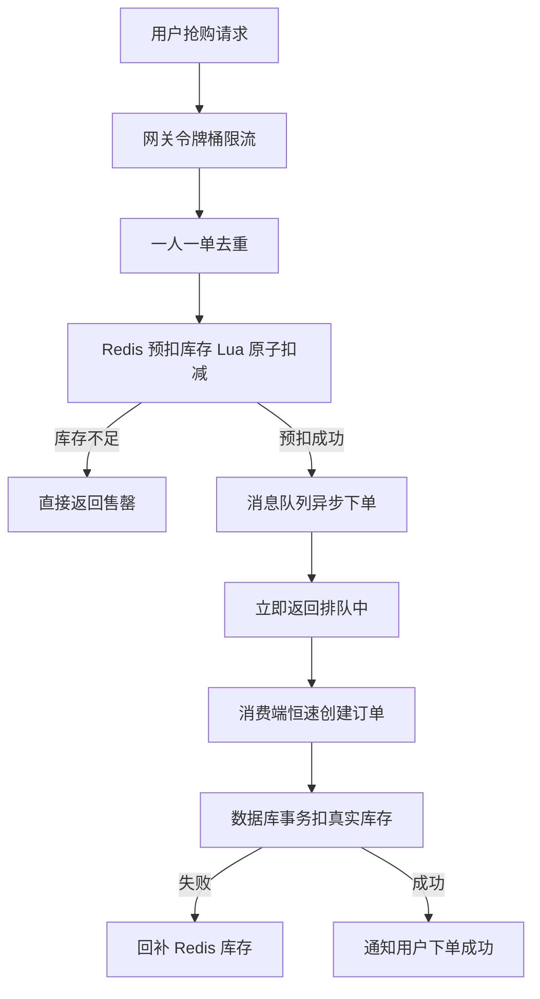

## NODE-161：设计一个秒杀服务端（限流/预扣/队列）？
**答**：
- 三级漏斗：**网关限流挡量**（令牌桶，NODE-132）→ **Redis 预扣挡超卖**（Lua 原子扣减）→ **MQ 削峰挡 DB**（恒速消费，NODE-144）。
- 入口毫秒级返回：校验 → 一人一单去重 → 预扣 → 入队 → 202 + 排队凭证；前端轮询或 WS 查结果。
- 数据库最终一致：消费端事务里 `UPDATE stock SET n = n - 1 WHERE sku = ? AND n > 0` 扣真实库存，失败回补 Redis。
- 收尾细节：超时未支付释放库存（延迟消息）、热点 sku 库存分桶（把一个 key 拆 10 个降低竞争）。



```javascript
const SECKILL_LUA = `local s = tonumber(redis.call("get", KEYS[1]) or "0")
if s <= 0 then return -1 end
redis.call("decr", KEYS[1])
return s - 1`;

app.post('/seckill/:skuId', limiter({ qps: 5000 }), async (ctx) => {
  const uid = ctx.state.uid;
  if (!(await redis.set(`seckill:dup:${ctx.params.skuId}:${uid}`, 1, 'PX', 86400000, 'NX'))) {
    ctx.throw(409, '重复参与');                       // 一人一单
  }
  const left = await redis.eval(SECKILL_LUA, 1, `stock:${ctx.params.skuId}`);
  if (left < 0) { ctx.status = 409; ctx.body = { msg: 'sold out' }; return; }
  const orderId = genOrderId();
  await orderQueue.add('seckill', { skuId: ctx.params.skuId, uid, orderId },
    { attempts: 5, backoff: { type: 'fixed', delay: 500 } });
  ctx.status = 202;
  ctx.body = { orderId, status: 'PROCESSING' };       // 异步结果页
});
```

## 追问（补充）

**追问**：

1. Redis 预扣成功但 MQ 投递失败，库存白扣了怎么办 → 预扣后先写本地请求记录再投递，投递失败由定时补偿扫描回补，或用 Redis Stream 做持久化入队，避免预扣与入队之间出现真空。
2. 分桶后用户看到有货但下单失败率高怎么办 → 分桶只用于削峰计数，最终以 DB 条件更新为准，失败回补对应桶并返回排队中而不是售罄，前端二次轮询拿真实结果。
3. 队列积压 10 万、消费能力跟不上怎么降级 → 按 sku 丢弃超过 TTL 的排队消息视为售罄，同时把入口限流阈值动态下调到消费能力的 1.2 倍，宁可早拒也不要让用户等 5 分钟。
