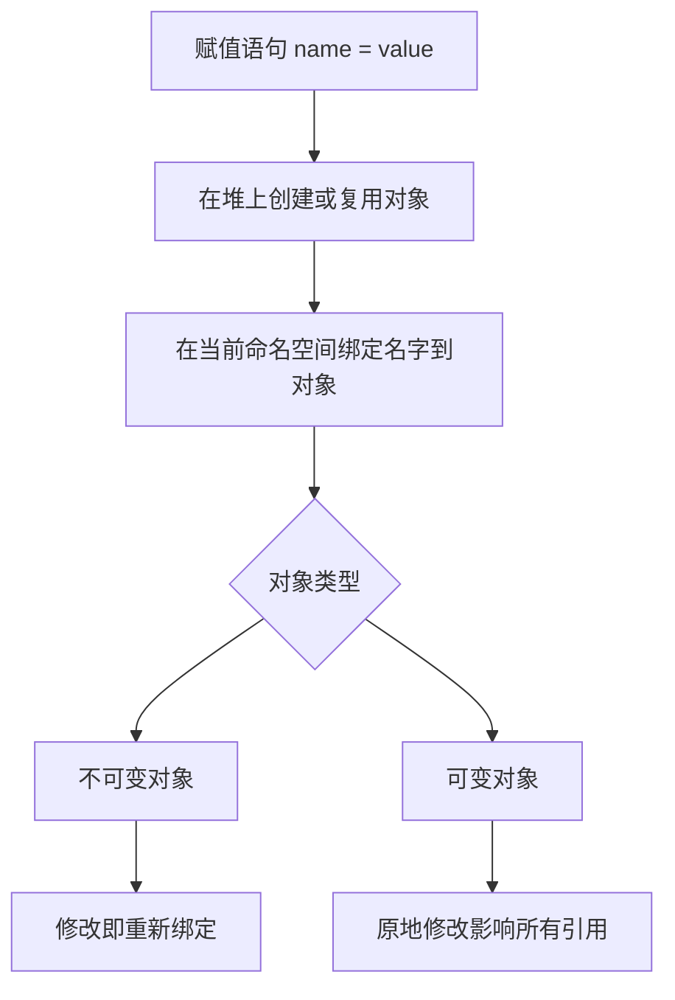

### Q006 · 小整数缓存与字符串驻留

> 难度:★★☆ | 标签:内存, 对象模型

**问**:为什么 `-5 <= x <= 256` 的整数 `is` 比较结果是 True?字符串驻留是什么机制?

**答**:CPython 启动时预创建 -5 到 256 的整数对象,所有引用指向同一份,节省频繁小整数的分配开销。字符串驻留(interning)把符合标识符规则的短字符串放进内部字典复用,编译期的字面量常自动驻留,运行期拼接的字符串通常不驻留,可用 `sys.intern()` 强制。这些都是 CPython 实现细节,不是语言规范。

```python
# file: code/01_语言核心与底层/q006_interning.py
import sys

if __name__ == "__main__":
    a = 100
    b = 100
    print(a is b)        # True,小整数缓存

    c = 257
    d = 257
    print(c is d)        # 交互模式下可能 False,脚本里同一次编译可能 True

    s1 = sys.intern("hello" + "!")
    s2 = sys.intern("hello!")
    print(s1 is s2)      # True,显式驻留

    big = "".join(["x"] * 1000)
    print(sys.getsizeof(big) > 0)  # str 有独立存储
```

**追问**:1) 驻留有什么实际用途?——在需要大量字符串相等比较的场景(如解析器符号表),驻留后可先用 `is` 快速判等,哈希也只算一次。2) 为什么要有小整数缓存?——-5 到 256 在下标计算、循环计数中出现极频繁,预创建单例避免反复分配释放;同理 None、True、False、空 tuple 都是共享单例。3) `sys.intern` 有什么代价?——驻留字符串进入内部表且生命周期长,经典实现里不随对象回收,只应对高重复、长期存在的字符串(标识符、枚举名),不要对任意用户输入 intern。


