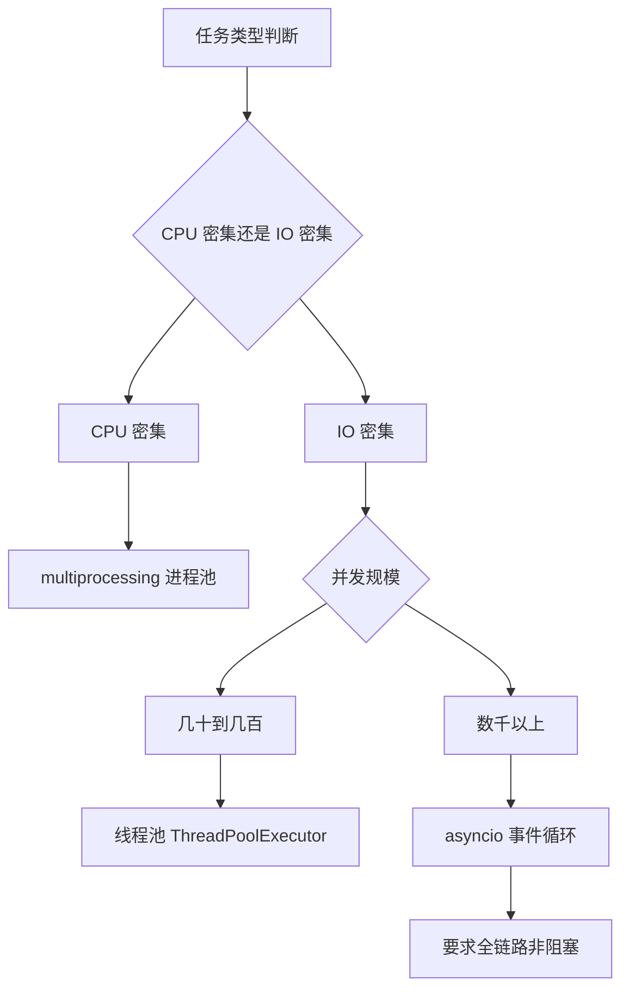

### Q011 · 线程、进程、协程如何选型

> 难度:★★★ | 标签:并发, GIL

**问**:面对爬虫、图像批处理、上万连接的网关,分别选什么并发模型?

**答**:经验法则:CPU 密集用 multiprocessing(绕过 GIL,利用多核);IO 密集且并发量中等用线程或线程池;超高并发 IO 用 asyncio 协程,单线程事件循环,内存开销极小,但要求调用链支持异步且不能混入阻塞调用。也可以混合:进程池内再开事件循环。

```python
# file: code/01_语言核心与底层/q011_concurrency_choice.py
import asyncio
import time
from concurrent.futures import ThreadPoolExecutor

def blocking_fetch(url_id):
    time.sleep(0.2)              # 模拟阻塞 IO
    return f"resp-{url_id}"

async def async_fetch(url_id):
    await asyncio.sleep(0.2)     # 模拟非阻塞 IO
    return f"resp-{url_id}"

if __name__ == "__main__":
    t0 = time.perf_counter()
    with ThreadPoolExecutor(max_workers=10) as pool:
        results = list(pool.map(blocking_fetch, range(10)))
    print("线程池:", round(time.perf_counter() - t0, 2), "s")

    async def main():
        return await asyncio.gather(*(async_fetch(i) for i in range(10)))
    t0 = time.perf_counter()
    results = asyncio.run(main())
    print("协程:", round(time.perf_counter() - t0, 2), "s")
```

**追问**:1) asyncio 里调用了一个阻塞函数会怎样?——整个事件循环被卡住,所有协程都停摆;要用 `loop.run_in_executor` 或 `asyncio.to_thread` 把它丢到线程池。2) 线程池默认多大?有什么风险?——`ThreadPoolExecutor` 默认 `min(32, cpu+4)`;submit 无背压,任务无限堆积会内存上涨,生产要有界队列、拒绝策略和队列长度监控。3) 进程池之间怎么传数据?——经 pickle 序列化走管道,连接、锁等不可 pickle 对象传不过去;大数组走序列化是瓶颈,可用 `multiprocessing.shared_memory` 共享内存。


