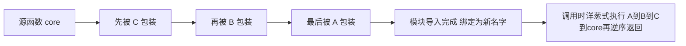

### Q015 · 多层装饰器的执行顺序

> 难度:★★★ | 标签:装饰器

**问**:`@a @b @c` 三层装饰器,谁先包装、谁先执行?

**答**:包装顺序自下而上:`f = a(b(c(f)))`,最靠近函数的 `c` 最先包装;执行顺序自上而下:进入 `a` 的 wrapper 后才进入 `b`,再进入 `c`,最后到达原函数;返回时逆序。可以把装饰器理解成洋葱模型,`@` 只是声明了组合顺序。

```python
# file: code/01_语言核心与底层/q015_decorator_order.py
import functools

def make(name):
    def deco(func):
        @functools.wraps(func)
        def wrapper(*args, **kwargs):
            print(f"enter {name}")
            result = func(*args, **kwargs)
            print(f"exit  {name}")
            return result
        return wrapper
    return deco

@make("A")
@make("B")
@make("C")
def core():
    print("  core running")

if __name__ == "__main__":
    core()
    # enter A -> enter B -> enter C -> core -> exit C -> exit B -> exit A
    print(core.__name__)
```

**追问**:1) 装饰器在什么时机执行「包装」这段代码?——模块被导入、装饰器语句被求值时立即执行,而不是函数第一次被调用时。2) 执行顺序怎么验证?——各 wrapper 进出时打印日志:输出 A 前置→B 前置→C 前置→原函数→C 后置→B 后置→A 后置,标准洋葱模型。3) 带参装饰器叠加时的求值顺序?——先从上到下求值工厂参数,再自下而上包装;`@a(arg)` 在 `@b` 之前求值,等价于 `f = a(arg)(b(f))`。


