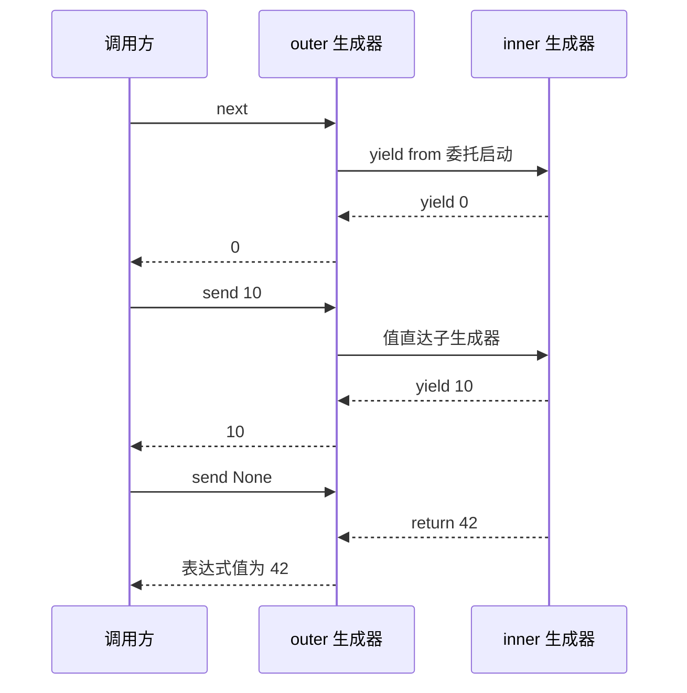

### Q020 · yield from 做了什么

> 难度:★★★ | 标签:生成器

**问**:`yield from sub` 与手写 for 循环透传有什么区别?

**答**:`yield from` 除了逐项转发产出,还建立双向通道:调用方 `send()` 的值直接传给子生成器,子生成器抛出的异常直接传播到调用方,子生成器 return 的值成为 `yield from` 表达式的值。等价于简化版的委托协议,也是 asyncio 旧式协程的基础。

```python
# file: code/01_语言核心与底层/q020_yield_from.py
def inner():
    total = 0
    while True:
        got = yield total        # 收到 send 的值,返回累计
        if got is None:
            return total         # return 值交给 yield from
        total += got

def outer():
    result = yield from inner()  # 委托给子生成器
    yield f"inner returned {result}"

if __name__ == "__main__":
    g = outer()
    print(next(g))       # 0,驱动到 inner 的 yield
    print(g.send(10))    # 10,直接写入 inner
    print(g.send(32))    # 42
    try:
        g.send(None)     # 结束 inner
    except StopIteration:
        pass
```

**追问**:1) async/await 与 yield from 是什么关系?——早期 asyncio 协程就是用 `yield from` 实现的委托,async/await 在语法和语义上取代了它,await 也保留了「让出控制权并等结果」的本质。2) `yield from` 表达式的值是什么?——子生成器 return 的返回值,`result = yield from gen` 是管道末端汇总数据的标准通道。3) 生成器式协程为什么被废弃?——`@asyncio.coroutine` + yield from 让生成器同时承担迭代与协程两种语义,容易误用;3.8 废弃、3.11 移除,原生 async/await 从语法上隔离了两种角色。


