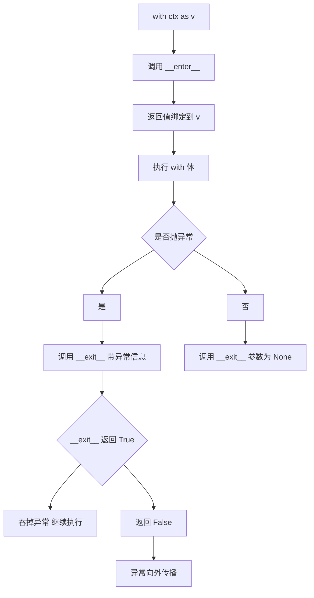

### Q025 · contextlib 的几种写法

> 难度:★★☆ | 标签:上下文管理器, 标准库

**问**:如何用 contextlib 快速实现上下文管理器?ExitStack 什么时候用?

**答**:`@contextmanager` 装饰生成器,yield 之前是 `__enter__`,之后是 `__exit__`,yield 值绑定给 as;异常会以生成器内 throw 的形式出现在 yield 处,不捕获就传播。`ExitStack` 用于动态管理不定数量的上下文(文件列表、嵌套锁),支持回调注册和异常时回滚。还有 `suppress`、`closing` 等小工具。

```python
# file: code/01_语言核心与底层/q025_contextlib.py
import contextlib
from contextlib import ExitStack, contextmanager

@contextmanager
def timer(label):
    import time
    start = time.perf_counter()
    try:
        yield label
    finally:
        print(f"{label}: {time.perf_counter() - start:.4f}s")

if __name__ == "__main__":
    with timer("work"):
        sum(range(100_000))

    with ExitStack() as stack:
        stack.enter_context(timer("inner"))
        files = [stack.enter_context(open(f"/dev/null")) for _ in range(2)]
        stack.callback(print, "cleanup callback runs on exit")
    print("ExitStack done")

    with contextlib.suppress(FileNotFoundError):
        open("no_such_file_here")
    print("suppress swallows the error")
```

**追问**:1) @contextmanager 的生成器 yield 两次会怎样?——抛 `RuntimeError: generator didn't stop`,一个上下文管理器实例只能进入一次。2) ExitStack 什么时候不可替代?——上下文数量运行时才能确定(批量文件、动态锁集合),或要把清理动作注册进调用方传入的栈(`callback`/`push`),with 嵌套写不出来。3) @contextmanager 里 yield 之前抛异常会怎样?——相当于 `__enter__` 失败,with 体不执行,异常直接向 with 语句传播;yield 之后的异常出现在 yield 处,由生成器决定吞还是放。


