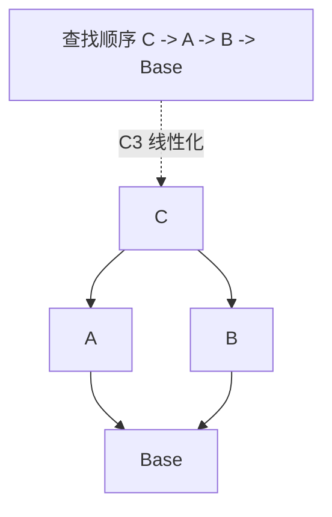

### Q031 · MRO 与菱形继承

> 难度:★★★ | 标签:继承, MRO

**问**:菱形继承下属性查找顺序如何确定?MRO 算法是什么?

**答**:Python 3 使用 C3 线性化:保证子类先于父类、保持定义时的声明顺序、且每个类只出现一次,无法满足时直接报 `TypeError: Cannot create a consistent MRO`。查看顺序用 `Cls.__mro__` 或 `Cls.mro()`。菱形继承中共同基类只初始化一次,前提是链上各处都用 `super()` 协作而不是直接写父类名。

```python
# file: code/01_语言核心与底层/q031_mro.py
class Base:
    def __init__(self):
        print("Base.__init__")

class A(Base):
    def __init__(self):
        print("A.__init__")
        super().__init__()

class B(Base):
    def __init__(self):
        print("B.__init__")
        super().__init__()

class C(A, B):        # 菱形:A、B 都继承 Base
    def __init__(self):
        print("C.__init__")
        super().__init__()

if __name__ == "__main__":
    C()
    # C -> A -> B -> Base,Base 只初始化一次
    print([c.__name__ for c in C.__mro__])
```

**追问**:1) MRO 能在运行时修改吗?——不能直接改,`__mro__` 只读;但重新组织继承或用 `register` 的虚拟基类(ABC)可以影响查找结果。2) C3 为什么会直接报错?——当局部优先序互相矛盾(基类列表要求 B 在 A 前,而另一处要求 A 在 B 前)时不存在一致线性化,宁可拒绝定义也不给隐式行为。3) 怎么证明 super() 沿 MRO 走?——在菱形继承每层 `__init__` 里打印类名,输出每个类恰好出现一次且顺序即 MRO;直接写父类名调用则会漏掉或重复公共基类。


