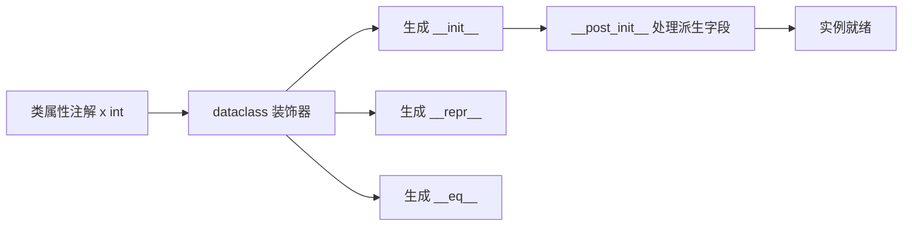

### Q037 · dataclass 的能力边界

> 难度:★★☆ | 标签:dataclass

**问**:dataclass 自动生成什么?field 与 __post_init__ 怎么配合?

**答**:`@dataclass` 依据类属性注解自动生成 `__init__`、`__repr__`、`__eq__`(可开关),`order=True` 生成比较方法,`frozen=True` 生成不可变实例,`slots=True`(3.10+)生成槽位。可变默认值必须用 `field(default_factory=list)`;`__post_init__` 在 `__init__` 后执行派生计算,配合 `field(init=False)` 接收派生字段。

```python
# file: code/01_语言核心与底层/q037_dataclass.py
from dataclasses import dataclass, field

@dataclass(order=True, frozen=True)
class Point:
    x: float
    y: float = 0.0

@dataclass
class Basket:
    items: list[str] = field(default_factory=list)
    total: int = field(init=False, default=0)

    def __post_init__(self):
        self.total = len(self.items)

    def add(self, item: str):
        self.items.append(item)
        self.total = len(self.items)

if __name__ == "__main__":
    print(Point(1, 2) < Point(3))
    b = Basket(["apple"])
    b.add("pear")
    print(b)                     # 自动 __repr__
    print(b == Basket(["apple", "pear"]))

    try:
        Point(1, 2).x = 9
    except Exception as e:
        print(type(e).__name__, e)   # frozen 禁止赋值
```

**追问**:1) dataclass 和 NamedTuple 怎么选?——需要不可变 + 元组解包/迭代语义选 NamedTuple;需要可变性、继承、丰富方法选 dataclass。2) frozen=True 是真不可变吗?——只阻止属性赋值(抛 FrozenInstanceError),可变字段的内容仍可原地修改;`__hash__` 需要 eq=True 且 frozen=True 才生成,frozen 但字段是 list 时依旧不可哈希。3) field(init=False) + __post_init__ 的典型用法?——派生字段(full_name = first + last)与构造后校验(价格 > 0),`__post_init__` 还可读 `field()` 元数据做类型转换。


