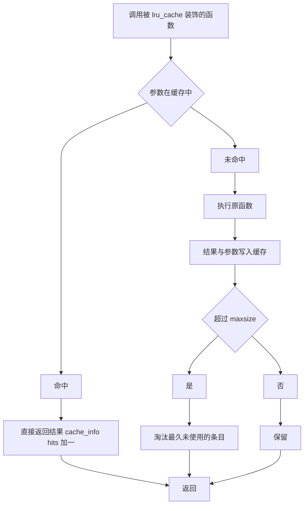

### Q045 · functools 缓存:lru_cache 与 cached_property

> 难度:★★☆ | 标签:缓存, 标准库

**问**:lru_cache 的参数含义?哪些函数不适合缓存?

**答**:`@lru_cache(maxsize=128, typed=False)` 基于 LRU 策略缓存函数结果,键为参数元组,要求参数可哈希;`maxsize=None` 退化为无限缓存 `functools.cache`(3.9+)。典型收益:纯函数重复计算(递归、解析结果)。不适合缓存:返回可变对象且调用方会修改它、参数含不可哈希对象、结果依赖外部可变状态(时间、数据库)的函数,以及内存爆炸风险大的无限缓存。实例方法缓存要注意 self 参与键导致的对象滞留。

```python
# file: code/01_语言核心与底层/q045_lru_cache.py
import functools

@functools.lru_cache(maxsize=None)
def fib(n):
    return n if n < 2 else fib(n - 1) + fib(n - 2)

calls = 0

@functools.lru_cache(maxsize=2)     # 容量小,观察淘汰
def slow_square(x):
    global calls
    calls += 1
    return x * x

if __name__ == "__main__":
    print(fib(60), "computed fast thanks to cache")
    print(fib.cache_info())         # hits / misses / maxsize

    for v in (2, 3, 4, 2, 3):
        slow_square(v)
    print("real calls:", calls)     # 2 和 3 被淘汰后重算
    print(slow_square.cache_parameters())

    slow_square.cache_clear()       # 手动清空
    print(slow_square.cache_info())
```

**追问**:1) 递归 memoization 之外还有什么替代?——`functools.cache` 无限版、自写 dict 记忆化、或直接改成动态规划迭代版,避免深递归栈溢出。2) lru_cache 装饰实例方法有什么坑?——self 进入缓存键,实例不释放导致内存泄漏且命中率差;替代方案是 `functools.cached_property`、把方法提为模块级纯函数,或显式管理键。3) 多进程部署下 lru_cache 还有效吗?——只在各自进程内有效,worker 间不共享、可能不一致;需要共享缓存就上 Redis 或确认缓存值纯派生自不可变输入才安全。


