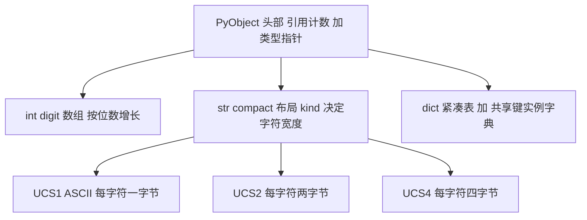

### Q1264 · str 的内部布局:kind 与 compact,拼接如何升宽

> 难度:★★★★☆ | 标签:str, 内存, CPython

**问**:同样是 10 个字符,`"a"*10` 和 `"中"*10` 的 getsizeof 差 35 字节,为什么?一个字符串的「宽度」会变吗?

**答**:CPython 的 str 是 compact 布局:对象头 + 字符数据紧挨着,数据宽度由「最大码点」决定,分三档 kind——UCS1(纯 ASCII/latin-1,1 字节/字符)、UCS2(≤0xFFFF,2 字节)、UCS4(4 字节)。所以 10 个 `a` 是 59 字节、10 个 `中` 是 94 字节(2×10+头)、10 个 emoji 是 134 字节。kind 在创建时定型,拼接等操作按两边的最大 kind 产出结果——一个纯 ASCII 串混入一个 `中`,结果整体升为 UCS2,内存翻倍;这就是「日志里混入一个 emoji,内存多一截」的机制解释。读操作(切片、find)不改变 kind,`str.encode` 才是跨宽度常量化的出口。

```python
# file: code/01_语言核心与底层/q1264_str_layout.py
import sys

if __name__ == "__main__":
    samples = [("ascii UCS1", "a" * 10),
               ("中文 UCS2", "中" * 10),
               ("emoji UCS4", "\U0001f600" * 10)]
    for tag, s in samples:
        print("%-10s len=%d sizeof=%d" % (tag, len(s), sys.getsizeof(s)))
    print("升宽: 'aa' + '中' sizeof =", sys.getsizeof("aa" + "中"),
          "| 'aa' sizeof =", sys.getsizeof("aa"))
    print("编码后回到字节宽度:", len(("a" * 10).encode("ascii")), "bytes")
```

**追问**:1) 为什么 `sys.getsizeof("")` 不是 0?——compact 布局也有固定对象头(约 49 字节),海量小字符串的开销大头是头部而非数据,这也是 intern 与缓存存在的理由(Q405)。2) kind 升宽什么时候发生?——三种宽度(1/2/4 字节)对应拉丁/BMP/星平面;拼接更宽字符时整串重分配升宽;ASCII 串有最紧凑的布局,这就是「少用 emoji 键」的微观依据。3) compact 布局的意义?——PEP 393 把字符数据紧跟对象头存放、去掉指针间接,内存省且缓存友好;getsizeof 反映 kind 与头部大小。4) 生产陷阱?——海量小串(百万级标签)头部开销远超数据,intern 或改编码;流式拼接依赖 += 的 refcount==1 特化不可移植,join 才是正解(Q1293)。


