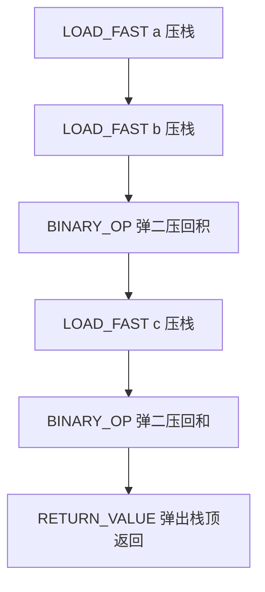

### Q1266 · 栈式虚拟机:字节码如何在求值栈上跑起来

> 难度:★★★☆☆ | 标签:字节码, 解释器

**问**:CPython 的字节码为什么叫「栈式」?`a * b + c` 在栈上发生了什么?

**答**:CPython 是基于栈的虚拟机:指令不直接寻址寄存器,而是把操作数压进一个求值栈(stack),运算指令从栈顶取数、把结果压回。`a * b + c` 编译为 LOAD_FAST a、LOAD_FAST b(压两个操作数)、BINARY_OP(弹出两个,相乘后压回积)、LOAD_FAST c、再 BINARY_OP 相加、RETURN_VALUE 弹出栈顶返回。栈式设计的优点是指令紧凑(操作数隐含在栈序里)、解释器实现简单;代价是指令条数多、难以做寄存器分配。3.11 的内联缓存(Q1259)与零开销异常(Q1260)都建立在「指令 + 求值栈 + 异常表」这套骨架上,读懂栈的进出是读 dis 输出的第一步。

```python
# file: code/01_语言核心与底层/q1266_eval_stack.py
import dis


def calc(a, b, c):
    return a * b + c


if __name__ == "__main__":
    for ins in dis.get_instructions(calc):
        print("%4d %-16s %s" % (ins.offset, ins.opname, ins.argrepr))
    print("栈视角: 两次 LOAD_FAST 压栈 -> BINARY_OP 弹二压一 -> LOAD_FAST c -> BINARY_OP -> RETURN_VALUE 弹出")
```

**追问**:1) 为什么 traceback 能给出精确行号?——每条指令带着行号表(linetable,PEP 657 后按指令粒度),异常沿栈回退时逐帧查表即可定位(见 Q409)。2) 为什么选栈式虚拟机?——指令无需编码操作数地址,编译简单、字节码紧凑;寄存器式(Lua)分派次数少但要寄存器分配——CPython 选栈式,3.11 特化+内联缓存补回性能。3) 求值循环的演进?——大 switch 分派,3.11 起栈顶缓存与自适应特化、computed goto;每条指令的栈深度由编译器静态保证。4) 生产陷阱?——手写字节码/改 co_code 是黑魔法;「指令数少=快」不成立(分派、缓存、特化才是关键);字节码跨版本不兼容,marshal 缓存要按版本隔离。


