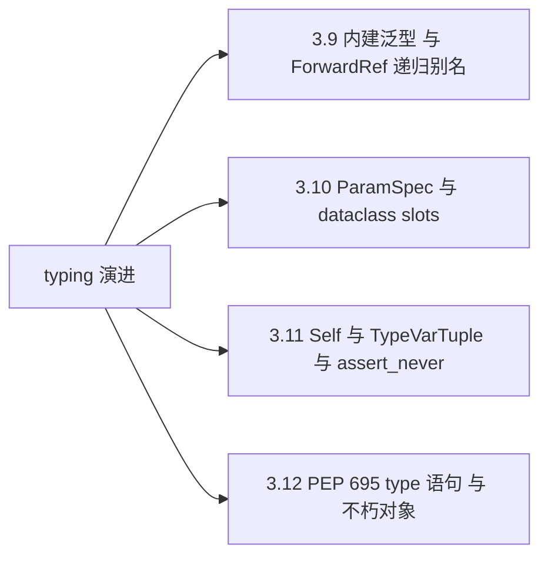

### Q1271 · TypeVarTuple:可变长度泛型元组

> 难度:★★★★☆ | 标签:typing, PEP 646, 泛型

**问**:`Tuple[int, str]` 能精确表达两个元素,「任意长度且每个位置类型各异」的元组怎么标?shape 级别的张量库为什么需要它?

**答**:3.11 的 PEP 646 引入 TypeVarTuple 与 Unpack:`Ts = TypeVarTuple("Ts")`,`tuple[Unpack[Ts]]` 表示「捕获任意数量的类型参数」——`Array[int, str, float]` 是三元素、每个位置类型独立,而不是 `Tuple[T, ...]` 那种「同构任意长」。典型应用是张量形状(NCHW 每维一个类型参数)、可变参数回调的精确签名、`zip`/`map` 返回值的多位置类型追踪。运行时它只是静态工具,不产生任何开销;3.10- 的替代方案只有 `Tuple[T, ...]`(丢位置信息)或手写若干 arity 的 overload。与 ParamSpec 对比着记:ParamSpec 捕获「函数参数列表」,TypeVarTuple 捕获「类型列表」,一个面向调用,一个面向类型容器。

```python
# file: code/01_语言核心与底层/q1271_typevartuple.py
from __future__ import annotations

import sys


def widths_of(*rows: tuple) -> list:
    return [len(r) for r in rows]


if __name__ == "__main__":
    print("python:", sys.version.split()[0])
    if sys.version_info >= (3, 11):
        from typing import TypeVarTuple, Unpack   # PEP 646
        Ts = TypeVarTuple("Ts")
        print("3.11+: tuple[Unpack[Ts]] 可表达异构可变元组")
    else:
        print("3.10-: 只有 Tuple[T, ...] 的同构近似")
    print(widths_of((1, 2), ("a",), (True, False, None)))
```

**追问**:1) Unpack 和 ParamSpec 能混用吗?——可以,`Callable[Concatenate[int, P], tuple[Unpack[Ts]]]` 这类组合 3.11+ 合法,但可读性急剧下降,建议只在公共 API 层使用。2) TypeVarTuple 的语义?——Ts 代表「类型元组」,Unpack[Ts] 在类型位置展开;典型场景 shape 类 API:Array[float, Height, Width];PEP 646、3.11 落地。3) 与 *args 的关系?——`def f(*args: Unpack[Ts])` 让变长参数各位置类型都被追踪;旧式 Tuple[T, ...] 只能表达「全部同型」。4) 生产陷阱?——3.10- 不可用,需要版本门控;内部 API 也上 Ts 会把类型签名变成天书;泛型别名里 *Ts 与 *args 混淆导致检查器报错。


