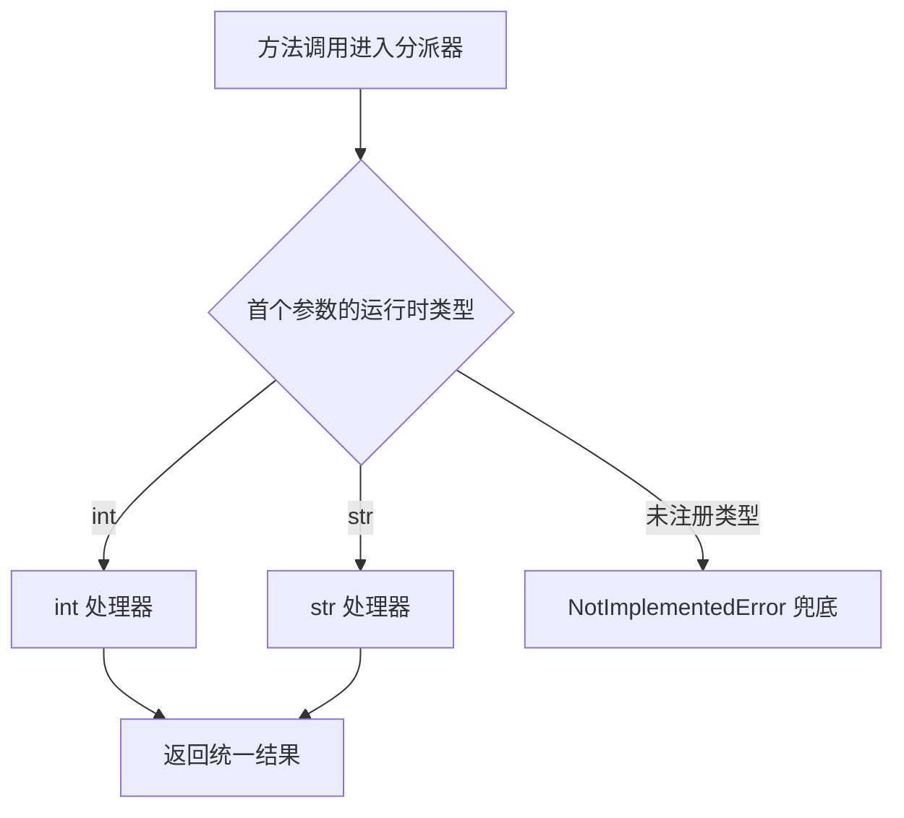

### Q1276 · singledispatchmethod:类方法的类型分派

> 难度:★★★☆☆ | 标签:singledispatch, 多态, functools

**问**:一个类方法要按第一个参数的类型走不同分支,if/elif isinstance 堆山之外,标准库给了什么?它和虚函数多态的区别是什么?

**答**:`functools.singledispatchmethod`(3.8+)把「按类型分派」做成装饰器:基方法写 NotImplementedError 兜底,各 `@render.register(int)` 注册处理器,运行时按「第一个非 self 参数」的运行时类型选分支,支持虚子类(注册 ABC,Q477)与 MRO 顺序解析。它与继承多态的正交关系:多态按「接收者类型」分派, singledispatch 按「参数类型」分派——visitor 模式的 Python 轻量版。坑有两处:注册顺序影响同类型竞争(见 Q427 的函数版);分派只看运行时类型不看泛型参数,`list[int]` 与 `list[str]` 是同一个 list。未注册类型抛 NotImplementedError,记得留兜底分支。

```python
# file: code/01_语言核心与底层/q1276_singledispatch_method.py
from functools import singledispatchmethod


class Renderer:
    @singledispatchmethod
    def render(self, value):
        raise NotImplementedError("no renderer for %r" % (value,))

    @render.register(int)
    def _(self, value):
        return "int:%d" % value

    @render.register(str)
    def _(self, value):
        return "str:%s" % value


if __name__ == "__main__":
    r = Renderer()
    print(r.render(42), "|", r.render("hi"))
    try:
        r.render(1.5)
    except NotImplementedError as e:
        print("fallback:", e)
```

**追问**:1) 能按「第二个参数」分派吗?——singledispatch 只支持第一个非 self 参数;要按任意位置分派需自己在入口处路由,或改用 match 语句。2) 与 singledispatch 的差别?——singledispatchmethod 是 descriptor 包装,分派仍按「self 之后的第一个参数」类型;可叠加 classmethod/staticmethod 组合。3) 注册与解析机制?——.register 按类型层级注册,运行时按 MRO 找最近实现;基类/抽象类注册合法,注册顺序无关。4) 生产陷阱?——新类型没 register 运行时 NotImplementedError,边界要有兜底实现;按注解误以为支持多参数分派;dispatch 表不感知运行期新定义的子类(要重新注册)。


