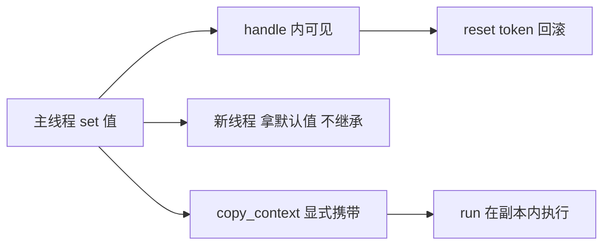

### Q1281 · contextvars:请求级上下文的正确传播方式

> 难度:★★★☆☆ | 标签:contextvars, 并发, 上下文

**问**:同一个函数调用链要透传 request_id,层层传参太丑,全局变量在并发下串号。contextvars 怎么解决?

**答**:contextvars.ContextVar 是「按上下文隔离的动态作用域变量」:set 返回 token,reset(token) 精确回滚;每个执行单元拿到的值互不可见——新线程从空上下文启动(拿到 default),asyncio 的每个 Task 在创建时快照当前上下文并独立变更。传播规则是本题核心:线程不自动继承,需要 `contextvars.copy_context().run(fn)` 显式携带;协程天然继承创建时刻的值。典型应用是日志 request_id(Q501 的 Filter 读取 ContextVar)与 APM 追踪,替代 threading.local(threading.local 在协程下会串号,因为多个 Task 共享线程)。约束:只在请求边界 set、在 finally 里 reset,别把 ContextVar 当可变容器存业务状态。

```python
# file: code/01_语言核心与底层/q1281_contextvars.py
import contextvars
import threading

request_id = contextvars.ContextVar("request_id", default="none")


def worker(tag):
    print(tag, "sees:", request_id.get())


def handle(rid):
    token = request_id.set(rid)
    try:
        worker("inside handle")            # 同一线程内可见
    finally:
        request_id.reset(token)            # 精确回滚,不留污染


if __name__ == "__main__":
    handle("req-1")
    worker("main thread after reset")
    t = threading.Thread(target=worker, args=("other thread",))
    t.start()
    t.join()                               # 线程不继承:拿到 default
    ctx = contextvars.copy_context()
    print("explicit copy_context().run:", ctx.run(request_id.get))
```

**追问**:1) 为什么 asyncio Task 串不了号而 threading.local 会?——Task 创建时复制当前上下文,后续 set 只影响副本;线程内的所有协程共享同一个 threading.local,一个协程 set,其余全部可见。2) 传播的完整模型?——Context 是「线程/任务级」变量袋:Task 创建拷贝快照、Context.run 隔离执行、set 只写当前上下文;跨任务传值要么创建前 set、要么显式传参。3) 与中间件的配合?——请求入口 set(request_id/user),链上任何 await 点读取一致;worker 常驻线程记得 finally reset,防止污染下一个请求。4) 生产陷阱?——任务内部 set 指望「回传」给调用方(不会);忘记 reset 长命 worker 串号;把 contextvars 当缓存用(请求结束值还在但已过期)。


