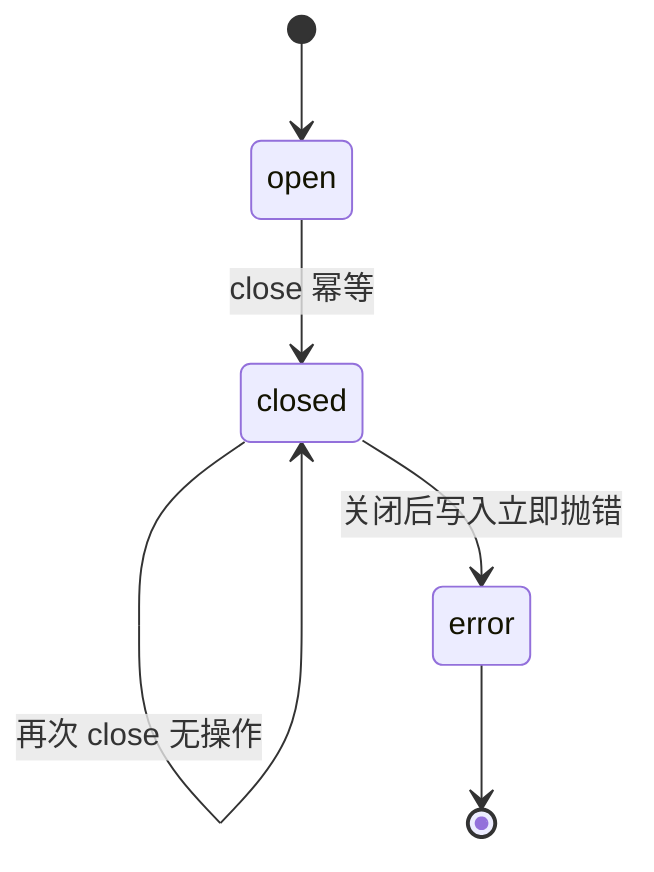

### Q1288 · breakpoint() 与 pdb:最小调试工作流

> 难度:★★☆☆☆ | 标签:pdb, 调试, 工程实践

**问**:breakpoint() 是什么糖?生产环境怎么一刀切禁用它?不想交互式单步时,pdb 还能怎么用?

**答**:breakpoint()(3.7+,PEP 553)是 `import pdb; pdb.set_trace()` 的可配置入口:解释器查环境变量 PYTHONBREAKPOINT 决定行为——设为 0 直接 no-op,设为 `pkg.mod.func` 可换成第三方调试器,生产镜像里 `PYTHONBREAKPOINT=0` 一行环境变量就能禁掉所有遗留断点。非交互用法:出异常后用 `pdb.post_mortem()` 回放现场;或直接用底层 `bdb.Bdb` 子类编程式下断点、收集行事件——CI 里做「最小复现」很顺手。交互模式的核心命令就几条:l(看代码)、n/s(步过/步入)、p expr(打印)、w(栈)、c(继续),面试能报出来即可,重要的是「断点是代码还是环境变量」这个可控性问题。

```python
# file: code/01_语言核心与底层/q1288_breakpoint_pdb.py
import bdb
import os


def divide(a, b):
    result = a / b
    return result


if __name__ == "__main__":
    os.environ["PYTHONBREAKPOINT"] = "0"
    print("PYTHONBREAKPOINT =", os.environ["PYTHONBREAKPOINT"])
    breakpoint()                        # 已被环境变量禁用,不会进 pdb
    print("breakpoint() disabled, continuing")

    lines_hit = []

    class Tracer(bdb.Bdb):
        def user_line(self, frame):
            lines_hit.append((frame.f_code.co_name, frame.f_lineno))
            self.set_continue()         # 收集一行即放行到底

    tr = Tracer()
    tr.set_break(divide.__code__.co_filename,
                 divide.__code__.co_firstlineno + 1)
    tr.runcall(divide, 6, 3)
    print("bdb hit lines:", lines_hit)
```

**追问**:1) post_mortem 和 set_trace 的区别?——set_trace 在调用处暂停向前执行,post_mortem 拿着已有的 traceback 只读回放帧与变量,不需要 tty 也能在脚本里跑。2) breakpoint() 的机制?——sys.breakpointhook 默认进 pdb;PYTHONBREAKPOINT 环境变量可换调试器或禁用(=0),与代码解耦——「留 breakpoint 不留 import」是可发布写法。3) 最小调试工作流?——复现 → breakpoint()/pdb 单步 → p/pp 看值、l 看上下文、w 看栈 → 修复;远程调试上 debugpy,不要裸 pdb 塞生产。4) 生产陷阱?——breakpoint 留在生产路径且环境没禁用(挂住请求);PYTHONBREAKPOINT=0 忘配导致误触发;调试器改时序,复现不出的问题要换日志埋点。


