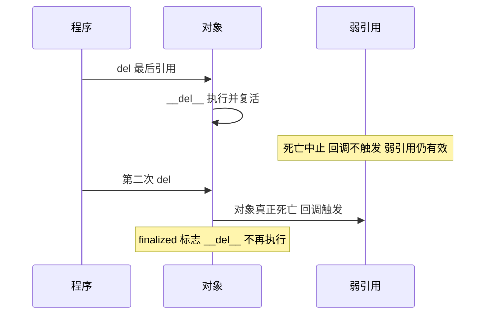

### Q1291 · 复活的时序:复活后弱引用为什么不失效

> 难度:★★★★★ | 标签:resurrection, weakref, 终结

**问**:`__del__` 里复活自己之后,weakref 的回调会立刻触发吗?对象第二次死亡时 __del__ 还会跑吗?

**答**:CPython 实测顺序(3.9/3.11 一致):第一次失去最后引用 → __del__ 执行并在其中重建引用 → 「死亡流程」被中止,弱引用不清理、回调不触发,`wr()` 依然返回活对象——因为对象根本没死成,清理动作(包括弱引用)只有真正 dealloc 时才发生。对象第二次失去引用 → 这次没有 __del__(PEP 442 给对象打了 finalized 标志,终结器对同一对象只执行一次,防无限复活循环)→ 弱引用此刻才清空、回调此刻才触发。这组时序解释了三个面试高频误区:「复活后回调马上响」(错)、「__del__ 每次死亡都跑」(错)、以及 Q546 的结论——复活的语义横跨引用计数路径与 GC 路径,细节全部是实现定义,工程上只能把它当事故,不能当机制。

```python
# file: code/01_语言核心与底层/q1291_resurrection_timing.py
import gc
import weakref

events = []


class Phoenix:
    def __del__(self):
        events.append("del")
        globals()["keep"] = self        # 复活


if __name__ == "__main__":
    p = Phoenix()
    ref = weakref.ref(p, lambda r: events.append(
        "cb, obj %s" % ("dead" if r() is None else "alive")))
    del p                               # 第一次死亡:__del__ 复活对象
    print("after 1st drop:", events, "| wr alive:", ref() is not None)
    events.clear()
    del keep                            # 第二次真正死亡
    print("after 2nd drop:", events, "| __del__ 不再执行, 回调此刻触发")
    events.clear()
    gc.collect()
    print("PEP 442: 终结器对同一对象最多一次, 复活不可依赖")
```

**追问**:1) 为什么终结器只跑一次是必须的?——不限制的话,每次 __del__ 都复活就能构造永不回收的对象,GC 等于失效;finalized 标志是「防 DoS 的语言级保证」。2) 复活与弱引用的时序?——终结器先执行(对象此刻重新可达),弱引用的清空发生在「最终不可复活」判定之后;所以 __del__ 里复活,弱引用还未失效——这是本题观测到的现象根源。3) 复活者的后续?——对象按普通对象继续存活,但终结器不再有第二次;它引用的资源要靠业务代码显式管理,语言层不再兜底。4) 生产陷阱?——用「weakref 回调没触发」判断对象存活(复活场景误判);复活是调试噩梦,终结器只日志不自救;复活对象持有的句柄泄漏。


