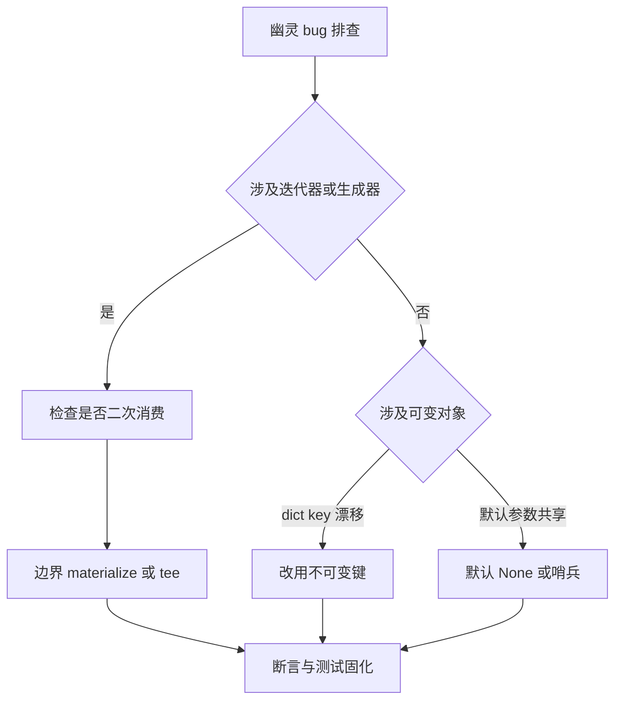

### Q1296 · 迭代器一次性:隐式耗尽的三类事故

> 难度:★★☆☆☆ | 标签:迭代器, 生成器, 疑难杂症

**问**:同一个迭代器传给两个函数,第二个为什么拿到的永远是空的?哪三类写法最容易踩?

**答**:迭代器协议是一次性状态机:__next__ 走到底就永久停在 StopIteration,不会有任何报错提示「你已经在消费空流」。三类高频事故:其一,生成器/文件对象被两个函数先后消费,第二个静默得到空结果(不抛错!);其二,把 tee 之外的「看似可多次迭代」对象当 list 用,比如 `sum(x) + max(x)` 对同一生成器求两次;其三,函数签名收 `iterable`,内部先 len() 再迭代——生成器没有 len,直接 TypeError,而文件对象 len 也不可用。防御三招:边界处一次性 `materialize = list(it)`(明确所有权转移)、需要多次遍历时用 itertools.tee 或直接传 list、函数文档写明「消费迭代器」。判别工具:iter(x) is x 为 True 即迭代器(只许走一遍),False 是容器(可反复迭代)。

```python
# file: code/01_语言核心与底层/q1296_iterator_exhaustion.py


def summarize(values):
    items = list(values)                # 注意:这一步就把迭代器吃光了
    if not items:
        return 0, None
    return sum(items), max(items)


def process(stream, tag):
    print("%-16s ->" % tag, summarize(stream))


if __name__ == "__main__":
    process(iter([3, 1, 4, 1, 5]), "iterator 1st")
    process(iter([]), "iterator empty")  # 耗尽后:静默的 0 与 None

    def gen():
        yield from [3, 1, 4, 1, 5]

    g = gen()
    process(g, "generator 1st")
    process(g, "generator 2nd")          # 静默空结果:最危险的事故形态
    print("iter(x) is x 判别:", iter([1]) is iter([1]) is False,
          "| 生成器是真迭代器:", iter(gen()) is not None)
```

**追问**:1) 为什么耗尽是「静默」的?——StopIteration 本身是正常结束信号,调用方用 for/sum 都会正常收到空;把「空」和「耗尽」合并是协议设计,代价就是这道题。2) 三类事故的共性?——把「迭代器」当「集合」传:API 收 iterator 被调两次、管道先 sum 再 list 得空、生成器存成属性复用;根因都是生命周期假设错误。3) 检测与预防?——类型注解 Iterator(一次性)vs Iterable(可重复)表达契约;文档明示;测试覆盖「二次调用」;需要多次遍历就先物化或提供工厂函数。4) 生产陷阱?——内部 list() 偷懒后又原样返回 iterator;日志/埋点先消费一遍主流程拿空;「本地能跑、线上偶发空」其实是共享生成器被并行消费。


