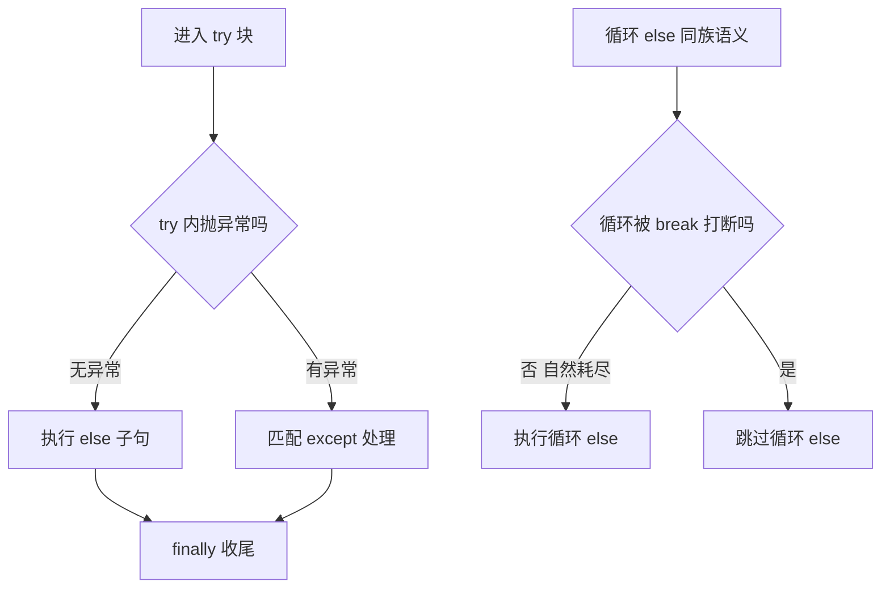

### Q1527 · try/else/finally 执行序:把 try 收窄到最小

> 难度:★★★☆☆ | 标签:异常, else 子句, 执行序

**问**:try 的 else 子句什么时候执行?为什么不把所有代码都塞进 try?

**答**:执行序:先 try;无异常 → 执行 else → finally;有异常 → 跳过 else 进第一个匹配的 except → finally。else 的存在意义是「把成功路径移出 try」:try 块收窄到只包真正会抛目标异常的语句,成功后的后续处理放 else,否则 except 会把成功路径上的业务异常误当成目标异常吞掉(见代码反例)。要点:① except 只捕获 try 块内抛的异常,else/finally 里抛的异常不会被同层 except 接住;② else 必须位于所有 except 之后、finally 之前,且没有 except 时不能单独出现(try/else 非法);③ 与 Q526 的分工:那里讲 finally 里 return 的覆盖与吞噬,本题讲 else 的边界与收窄原则。

```python
# file: code/01_语言核心与底层/q1527_try_else.py

PRICES = {"apple": 5, "banana": 2}


def parse_and_bill_narrow(line):
    """窄 try:只包真正会抛 ValueError 的类型转换。"""
    name, _, qty = line.partition(":")
    unit = PRICES[name]                # 查表错误如实抛 KeyError
    try:
        total = int(qty) * unit
    except ValueError:
        return None
    else:
        if total > 1000:
            raise ValueError("total 超限")   # 成功路径的问题不再被吞
        return total


def parse_and_bill_wide(line):
    """反例:try 拖得太宽,业务校验的异常被当成解析失败吞掉。"""
    try:
        name, _, qty = line.partition(":")
        unit = PRICES[name]
        total = int(qty) * unit
        if total > 1000:
            raise ValueError("total 超限")   # 业务校验,与解析无关
        return total
    except ValueError:
        return None                          # 业务错误被误归为解析失败


if __name__ == "__main__":
    print("narrow ok  :", parse_and_bill_narrow("apple:3"))
    print("narrow bad :", parse_and_bill_narrow("apple:x"))
    try:
        parse_and_bill_narrow("cherry:2")
    except KeyError as err:
        print("narrow miss:", "KeyError 如实抛出:", err)
    try:
        parse_and_bill_narrow("apple:400")
    except ValueError as err:
        print("narrow big :", "业务校验如实抛出:", err)

    print("wide ok    :", parse_and_bill_wide("apple:3"))
    print("wide bad   :", parse_and_bill_wide("apple:x"))
    print("wide big   :", parse_and_bill_wide("apple:400"), " # 业务错误被吞成 None")

    order = []
    try:
        order.append("try")
    except ValueError:
        order.append("except")
    else:
        order.append("else")
    finally:
        order.append("finally")
    print("execution  :", order)
```

**追问**:1) except 分支里再抛异常,会被同层其他 except 接住吗?——不会,同层 except 之间互不捕获,异常向外传播;finally 里抛新异常还会覆盖正在传播的旧异常,比「吞异常」更隐蔽。2) try 收窄为什么是原则?——else 让「常规语句」与「易错语句」分离:try 只包真正可能抛的那几行,except 的捕获面精确,无关异常不会误入;try 块越大,排查时越难定位是哪行炸的。3) 完整执行序?——try→(命中 except 或自然结束走 else)→finally 总收尾;else 抛的异常不被同层 except 捕获。4) 生产陷阱?——巨型 try 块误捕无关异常;else 里做本该 try 的事;finally 抛新异常覆盖旧异常(Q526);finally 里 return 直接吞异常。


