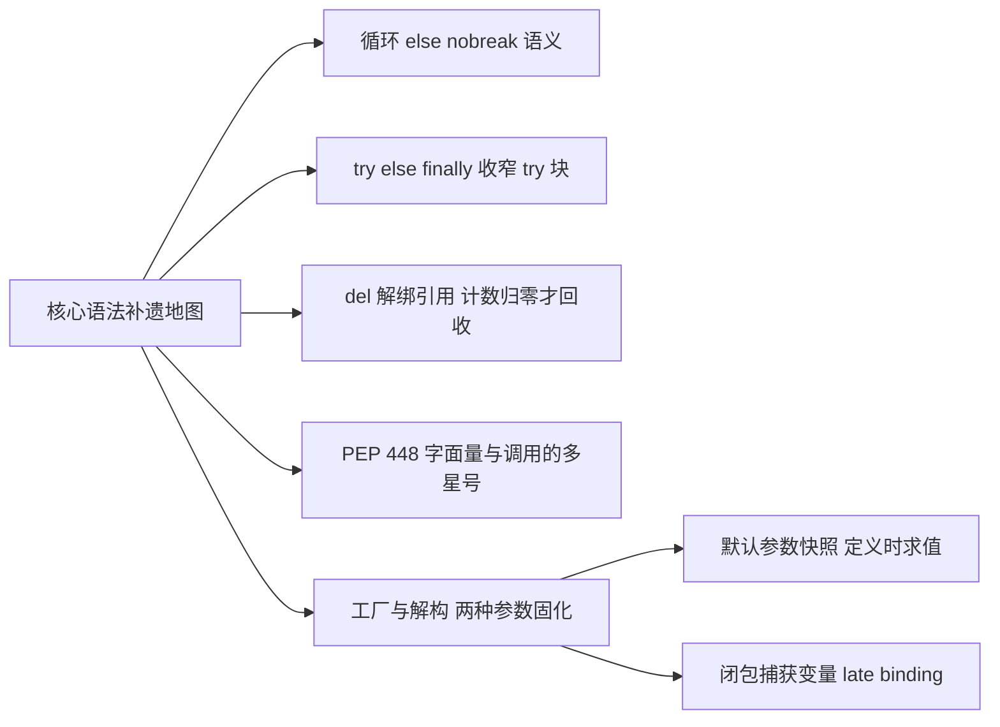

### Q1532 · 元组解构惯用法:交换、推进与星号收集

> 难度:★☆☆☆☆ | 标签:元组, 解构, 语法

**问**:多元赋值和元组解构有哪些惯用法?a, b = b, a 的背后发生了什么?

**答**:右侧先整体求值打包成 tuple,再按左侧模式解包——所以交换 a, b = b, a 无需临时变量,斐波那契 a, b = b, a+b 一次推进两个状态(两个新值都基于旧值,这是它比两行赋值语义更强的地方)。惯用法清单:星号收集 first, *rest = seq;嵌套解构 (a, (b, c)) = ...;循环里 for k, v in d.items() 直接解;enumerate/zip 的配对解构。边界:元素数不匹配 ValueError;一条赋值语句左侧只能有一个星号变量(Q540);解构不要求序列是元组,任何可迭代都行——解包生成器会把它耗尽。

```python
# file: code/01_语言核心与底层/q1532_tuple_unpack_idioms.py


def minmax(seq):
    """一次遍历同时返回两个值:调用方一行解构。"""
    it = iter(seq)
    try:
        low = high = next(it)
    except StopIteration:
        raise ValueError("minmax empty seq") from None
    for x in it:
        if x < low:
            low = x
        elif x > high:
            high = x
    return low, high


if __name__ == "__main__":
    a, b = 1, 2
    a, b = b, a                     # 打包再解包,无临时变量
    print("swap:", a, b)

    x, y = 0, 1
    for _ in range(8):
        x, y = y, x + y             # 状态对同步推进
    print("fib :", x)

    first, *rest = [10, 20, 30, 40]
    *init, last = rest
    print("head/tail:", first, rest, init, last)

    (name, (lat, lon)) = ("pei", (39.9, 116.4))    # 嵌套模式
    print("nested:", name, lat, lon)

    scores = {"alice": 91, "bob": 85}
    for who, score in scores.items():              # items 直接解构
        print("item :", who, score)

    print("minmax:", minmax([5, 3, 9, 1, 7]))
    try:
        a, b = (1, 2, 3)
    except ValueError as err:
        print("mismatch:", err)
```

**追问**:1) a, b = b, a+b 里右侧求值时机?——右侧先整体求值成 tuple 再解包,两个新值都基于旧值;这正是「先打包后解包」比两行顺序赋值更强的地方。2) 星号收集的语义细节?——a, *rest = it 的 rest 恒是 list(哪怕空);星号目标每条赋值语句最多一个;支持嵌套解构 (a, (b, c)) 表达树状结构。3) 字节码优化?——两元素交换被 ROT_TWO 优化掉临时元组,三元素以上才真的打包;解构长度不匹配直接 ValueError。4) 生产陷阱?——解构来源长度不可控(配 zip strict Q517 或先校验);嵌套解构可读性崩;`a, = it` 单元素解构的尾逗号被误删成 `a = it`;循环里 (k, v) 解构 enumerate 组合是标准惯用法。


