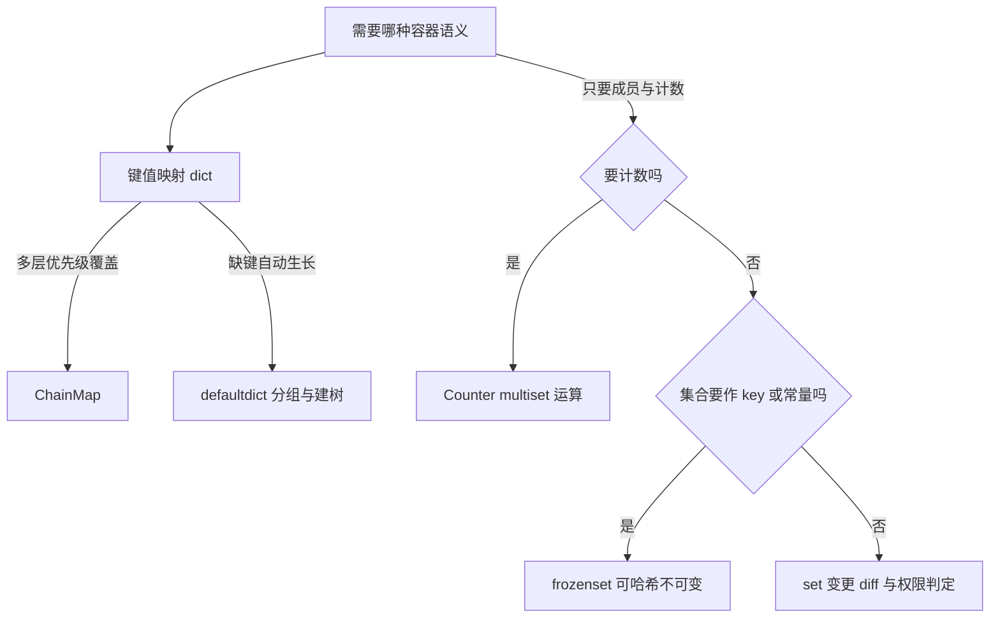

### Q1537 · 集合运算的工程应用:变更 diff 与权限判定

> 难度:★★☆☆☆ | 标签:set, 集合运算, 工程应用

**问**:上线前的服务变更 diff(新增了哪些、下线了哪些)怎么用集合一次算清?权限判断为什么写成子集判定?

**答**:三个高频模式:① 变更 diff——added = new - old、removed = old - new、kept = old & new、changed = old ^ new(对称差一把抓出所有变动项),报告输出前 sorted 保证可复现;② 权限与前置条件——「所需能力 ⊆ 已授予能力」一行 <= 表达,比逐项循环语义清楚还快;③ 多标签过滤——同时满足全部标签用 ⊆,命中任一用 & 非空。dict.keys() 视图直接支持集合运算,过滤字典不必先建 set;但视图是动态窗口(Q1265),拿到结果后字典再变不会回滚。集合无序,一切「报告类」输出都要排序或按稳定规则排列。

```python
# file: code/01_语言核心与底层/q1537_set_ops_diff.py

OLD_SERVICE = {"auth", "billing", "search", "notify"}
NEW_SERVICE = {"auth", "billing", "search-v2", "audit", "notify"}

GRANTED = frozenset({"read", "write", "export"})
REQUIRED_EXPORT = frozenset({"read", "export"})

DOCS = {
    "a1": {"python", "db"},
    "a2": {"python"},
    "a3": {"db", "cache"},
    "a4": {"cache", "queue"},
}


def diff_report(old, new):
    added = sorted(new - old)
    removed = sorted(old - new)
    kept = sorted(old & new)
    changed = sorted(old ^ new)
    return added, removed, kept, changed


if __name__ == "__main__":
    added, removed, kept, changed = diff_report(OLD_SERVICE, NEW_SERVICE)
    print("added  :", added)
    print("removed:", removed)
    print("kept   :", kept)
    print("changed:", changed)

    # 权限:所需 ⊆ 已授
    print("export allowed:", REQUIRED_EXPORT <= GRANTED)
    print("admin denied  :", not ({"admin"} <= GRANTED))

    # 标签过滤:全部命中用子集,任一命中用交集
    python_docs = sorted(k for k, tags in DOCS.items() if "python" in tags)
    tagged_all = sorted(k for k, tags in DOCS.items() if {"db", "cache"} <= tags)
    tagged_any = sorted(k for k, tags in DOCS.items() if tags & {"db", "queue"})
    print("python docs  :", python_docs)
    print("db AND cache :", tagged_all)
    print("db OR queue  :", tagged_any)
```

**追问**:1) dict.keys() 的集合运算和 set(d.keys()) 结果一样吗?——一样且更快,视图零拷贝直接运算;但视图是动态窗口,运算后底层字典再变,视图随之变。2) 变更 diff 的标准姿势?——added = new_keys - old_keys、removed 反向、changed 在键交集中比较值;权限判定 user & required 或 role | inherited;全部基于视图零拷贝。3) 底层复杂度?——集合运算 O(min(n,m)) 哈希探测;视图参与运算前会检查对方可迭代;大集合 diff 优于逐项 O(n×m) 循环。4) 生产陷阱?——把视图当静态快照存起来(底层变了数据漂移);diff 后忘记处理「键相同值不同」的第三类;权限判断用 list 循环 in 而不是集合运算。


