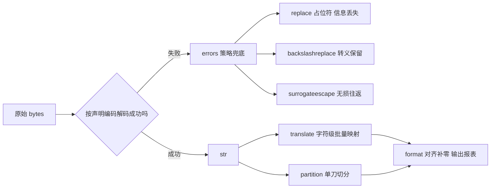

### Q1541 · 容错解码:errors 策略与脏字节流的处理

> 难度:★★★★☆ | 标签:编码, decode, 健壮性

**问**:拿到一份混着脏字节的外部日志,decode 直接炸了。errors 各策略的语义?如何既容错又不丢信息?

**答**:errors 策略决定坏字节的命运:strict(默认)直接抛 UnicodeDecodeError;replace 用 U+FFFD 占位(信息丢失);ignore 直接丢字节;backslashreplace 把坏字节转成 \xNN 字面转义,日志场景首选——既不中断又保留原始信息;surrogateescape 用代理区码点兜住坏字节,encode 时带同样参数可无损还原,适合「读进来还要原样写回」的管道;xmlcharrefreplace/namereplace 主要服务 encode 方向。工程降级链:按声明编码 strict → surrogateescape(保真)→ latin-1(永不失败但多字节会碎成乱码,仅作最后兜底)。原则:容错解码只在数据入口做一次,内部统一 str,别让错误策略渗透进业务层。

```python
# file: code/01_语言核心与底层/q1541_error_tolerant_decode.py

DIRTY_LOG = (b"[2026-11-05] user=\xe4\xb8\xad\xe6\x96\x87 action=login\n"
             b"[2026-11-05] note=\xff\xfe broken bytes here\n")


def try_strategies(payload):
    strategies = ("strict", "replace", "ignore", "backslashreplace",
                  "surrogateescape")
    out = {}
    for name in strategies:
        try:
            out[name] = payload.decode("utf-8", errors=name)
        except UnicodeDecodeError as err:
            out[name] = "!error: UnicodeDecodeError at byte %d" % err.start
    return out


def safe_display(text):
    """含代理区码点的字符串不能直接 print,转义后展示。"""
    return text.encode("ascii", errors="backslashreplace").decode("ascii")


if __name__ == "__main__":
    for name, text in try_strategies(DIRTY_LOG).items():
        if text.startswith("!error:"):
            print(f"{name:>16}: {text}")
        else:
            one_line = text.splitlines()[1]
            print(f"{name:>16}: {safe_display(one_line)}")

    # surrogateescape 往返:坏字节无损还原
    decoded = DIRTY_LOG.decode("utf-8", errors="surrogateescape")
    restored = decoded.encode("utf-8", errors="surrogateescape")
    print("roundtrip lossless:", restored == DIRTY_LOG)

    # replace 的占位符是什么
    print("U+FFFD is:", repr("\ufffd"),
          "len:", len(b"\xff".decode("utf-8", errors="replace")))

    # latin-1 永不失败,但多字节会碎成乱码——降级链的最后一步
    print("latin-1 fallback:", DIRTY_LOG.decode("latin-1").splitlines()[1][:30])
```

**追问**:1) surrogateescape 还原时用什么编码?——encode 也必须带 errors="surrogateescape";strict 编码遇到代理区码点会抛 UnicodeEncodeError,这正是它「无损往返」的设计点。2) errors 策略矩阵?——strict 抛错(默认,数据安全)、replace/ignore 损失数据(只用于展示/日志)、surrogateescape 无损往返(混合编码文件)、backslashreplace(展示转义);选型原则:数据层 strict/escape,展示层才容错。3) 底层映射?——不可解码字节映到 U+DC80–DCFF 代理区,encode 时映射回原字节;这是「不丢信息地穿过去」的官方通道。4) 生产陷阱?——日志层 replace 静默改写数据(排查时对不上);读写两侧 errors 策略不配对;把 surrogate 字符写进 JSON/数据库直接报错,要先 escape 回字节。


