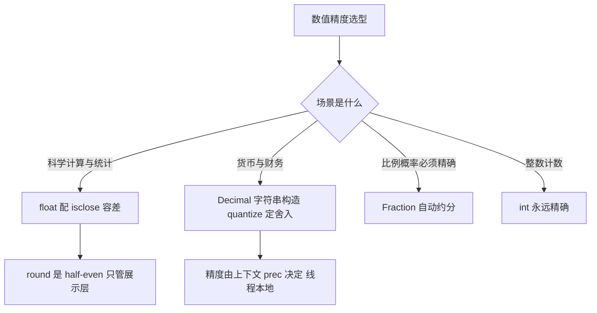

### Q1545 · 浮点相等性:isclose 的双容差设计

> 难度:★★★☆☆ | 标签:浮点数, isclose, 容差

**问**:判断两个浮点数「相等」的正确姿势?math.isclose 的 rel_tol 和 abs_tol 各管什么?

**答**:math.isclose(a, b, rel_tol=1e-09, abs_tol=0.0) 是浮点相等判断的正解:|a-b| <= max(rel_tol * max(|a|, |b|), abs_tol)。rel_tol 是相对容差,适配数量级未知的常规比较——1e12 与 1e12+0.1 相对误差 1e-13,应判相等;abs_tol 是绝对容差,专治跟 0 比较:rel_tol 对 0 永远失效(|a-0| <= rel_tol*|a| 只有 a==0 成立),isclose(1e-12, 0.0) 默认 False,必须给 abs_tol。要点:① 两种容差「满足其一」即判接近;② isclose 对称,交换参数结果一致;③ 不要手写 abs(a-b) < eps——尺度不明时它在大数上误判、在近零处漏判;④ NaN 与任何值(含自身)都 False,inf 与 inf 是 True,符合语义。

```python
# file: code/01_语言核心与底层/q1545_isclose_tolerance.py
import math


def naive_equal(a, b, eps=1e-9):
    return abs(a - b) < eps


if __name__ == "__main__":
    print("0.1+0.2 == 0.3 :", 0.1 + 0.2 == 0.3)
    print("isclose default:", math.isclose(0.1 + 0.2, 0.3))

    # 大数:绝对差 0.1,但相对误差极小——朴素 eps 误判
    big_a, big_b = 1e12, 1e12 + 0.1
    print("big naive:", naive_equal(big_a, big_b),
          "| isclose:", math.isclose(big_a, big_b))

    # 接近零:rel_tol 失效,必须给 abs_tol
    print("tiny vs 0 default:", math.isclose(1e-12, 0.0),
          "| with abs_tol:", math.isclose(1e-12, 0.0, abs_tol=1e-9))

    # 累加误差:sum 与 fsum 的对比(呼应 Q537)
    vals = [0.1] * 10
    print("sum:", repr(sum(vals)), "| fsum:", repr(math.fsum(vals)),
          "| isclose to 1.0:", math.isclose(sum(vals), 1.0))

    # isclose 对称
    print("symmetric:", math.isclose(100.0, 100.1, rel_tol=1e-3) ==
          math.isclose(100.1, 100.0, rel_tol=1e-3))
```

**追问**:1) isclose 判断 NaN 会怎样?——永远 False(NaN 与任何值含自身都不 close),正好符合 NaN 语义;inf 与 inf 是 close,inf 与有限数不是。2) 双容差的设计?——阈值 = max(rel_tol * max(|a|,|b|), abs_tol);rel_tol 管量级相对误差(默认 1e-09),abs_tol 管零附近(默认 0.0——比较 0 必须显式给,否则恒 False)。3) 对称与语义?——isclose(a, b) 对称;两个 inf 视为 close(差是 0 意义),这与 == 不同;math.isclose 与 cmath 版本口径一致。4) 生产陷阱?——比较含 0 的场景不给 abs_tol;把 rel_tol 当绝对差理解;测试里直接 == 比浮点造成 flaky;累计运算的中间值没约束容差传播。


