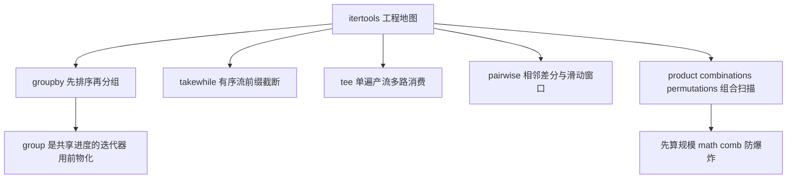

### Q1550 · product 与 combinations:组合扫描与规模防御

> 难度:★★★☆☆ | 标签:itertools, 组合, 配置扫描

**问**:三类组合迭代器的语义边界?配置矩阵扫描用哪个?combinations 遇到重复输入会怎样?

**答**:三个组合器的语义:product 笛卡尔积(参数矩阵、格点,repeat 控制自幂),combinations 不放回组合(无序、不重复选),permutations 全排列(有序)。规模先算后跑:C(n, k) 用 math.comb、n! 用 math.factorial,product 是各维度长度连乘——「看起来无害的三层 product」可能是百万级,惰性迭代器省内存但不省总时长。要点:① combinations 按输入位置取组合、不去值重:[1,1,2] 取 2 得 (1,1)、(1,2)、(1,2),要值去重先处理输入;② product(*config.values()) 能动态展开运行时才知的维度,等价多层 for;③ 结果是元组流,配 zip(keys, combo) 还原成 dict。

```python
# file: code/01_语言核心与底层/q1550_combinatorics.py
import math
from itertools import combinations, permutations, product

CONFIG = {"env": ("dev", "prod"), "pool": (4, 8), "tls": (True, False)}


def sweep_size(config):
    size = 1
    for values in config.values():
        size *= len(values)
    return size


if __name__ == "__main__":
    cases = list(product(*CONFIG.values()))
    print("sweep", sweep_size(CONFIG), "cases:")
    for i, combo in enumerate(cases, 1):
        print("  case", i, dict(zip(CONFIG.keys(), combo)))

    pool = list(range(5))
    print("combinations C(5,2):", len(list(combinations(pool, 2))),
          "expected", math.comb(5, 2))
    print("permutations P(4)  :", len(list(permutations(range(4)))),
          "expected", math.factorial(4))
    print("powerset size      :", sum(math.comb(5, k) for k in range(6)))

    dup = [1, 1, 2]
    print("combinations on dup:", list(combinations(dup, 2)),
          "按位置产生, 含重复值")
    print("value-dedup first  :", list(combinations(sorted(set(dup)), 2)))

    print("product with repeat:", list(product((0, 1), repeat=2)))
```

**追问**:1) product 比多层 for 循环好在哪?——维度是运行时的配置字典时 for 层数写不出来,product(*values.values()) 动态展开;静态固定维度时普通循环更直白。2) 规模防御怎么做?——乘积 N1×N2×... 在入口估算,超阈值拒绝或分批;结果必须流式消费(它是迭代器),物化 list 是 OOM 源;repeat 参数表达「同一维度重复」。3) 组合家族的选型?——product 全笛卡尔(重置重复);combinations 无序不重复;permutations 有序;排列组合问题先想清「顺序与重复」两个开关。4) 生产陷阱?——无界乘积 OOM;维度值是生成器(product 会先物化内部元组);把 combinations 当 product 用漏掉重复组合。


