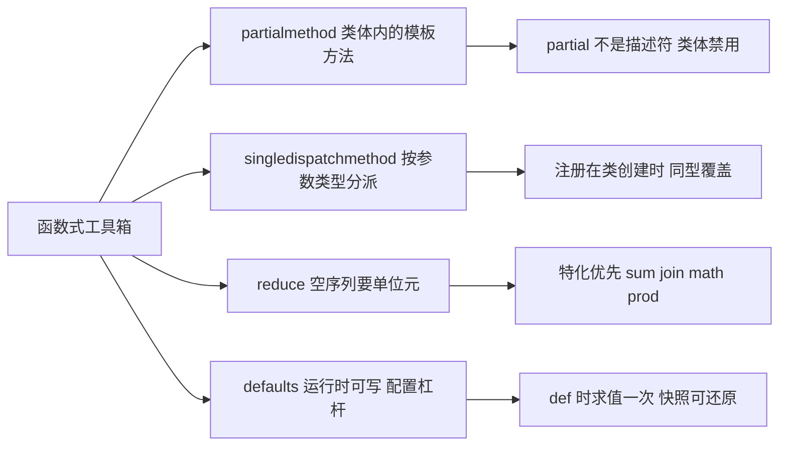

### Q1554 · __defaults__ 运行时读写:默认值的配置杠杆

> 难度:★★★★☆ | 标签:内省, 默认参数, 元编程

**问**:函数的默认值存在哪?怎么在运行时改默认值?这和可变默认参数陷阱是什么关系?

**答**:默认值存在函数对象上:位置/普通参数在 __defaults__(按序元组),keyword-only 在 __kwdefaults__(dict);两者是可写属性,运行时改掉影响之后所有调用。这与 Q004 的可变默认陷阱同源——默认值在 def 执行时求值一次并固定,所以「运行时读写默认值」既是配置杠杆也是事故源。工程用法:① 测试钩子——快照 defaults、替换、还原;② 按部署环境调整默认配置而无需改签名。纪律:① __defaults__ 长度必须与带默认值参数个数一致,形状错了下次调用才炸;② 闭包变量存在 cell 里不进 defaults,partial 固化的实参也不进;③ 改前存快照,改完必还原。

```python
# file: code/01_语言核心与底层/q1554_defaults_introspection.py


def connect(host="localhost", port=5432, *, timeout=3.0, retries=2):
    return (host, port, timeout, retries)


def temp_converter(c, offset=273.15):
    return c + offset


if __name__ == "__main__":
    print("connect defaults :", connect.__defaults__, connect.__kwdefaults__)
    print("call             :", connect())

    # 运行时改默认:影响之后所有调用
    connect.__defaults__ = ("db.internal", 6432)
    connect.__kwdefaults__["timeout"] = 0.5
    print("after mutate     :", connect())

    # 形状错误:defaults 长度与带默认值的参数数不符,下次调用才炸
    connect.__defaults__ = ("only-host",)
    try:
        connect()
    except TypeError as err:
        print("bad shape        :", err)

    # 测试钩子:快照 - 改 - 还原
    saved = temp_converter.__defaults__
    temp_converter.__defaults__ = (0.0,)
    print("shifted          :", temp_converter(25.0))
    temp_converter.__defaults__ = saved
    print("restored         :", temp_converter(25.0))

    # 同一默认可变对象被别名共享(Q004 的运行时视角)
    def append_log(msg, bucket=[]):
        bucket.append(msg)
        return bucket

    alias = append_log
    alias("first")
    print("shared bucket    :", append_log("second"),
          "| same object:",
          append_log.__defaults__[0] is alias.__defaults__[0])
```

**追问**:1) 改 __defaults__ 影响已 bind 的 partial 吗?——不影响,partial 创建时已拷贝实参;但它影响所有「未来」的普通调用,这正是配置杠杆与危险并存的原因。2) 杠杆的边界?——运行时改默认值是「隐形全局状态」:影响一切后续调用方,调试极难;合理场景仅限测试注入与初始化期调整;kw-only 默认在 __kwdefaults__,两者都要看到。3) 反射读取?——inspect.signature 显示的默认值来自这两个属性,改后签名视图同步变化——文档生成与校验都会受影响。4) 生产陷阱?——模块级改默认值无审计痕迹;并发读写默认元组的竞态;测试里改完忘记还原污染同进程其他测试。


