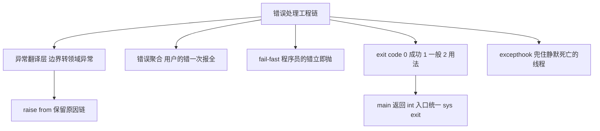

### Q1561 · excepthook:未捕获异常的两类兜底

> 难度:★★★☆☆ | 标签:excepthook, threading, 异常

**问**:线程里抛的异常为什么「悄悄消失」?sys.excepthook 和 threading.excepthook 各兜什么底?

**答**:两类未捕获异常两个兜底钩子:主线程未捕获异常走 sys.excepthook(type, value, tb)(默认打印 traceback 后以 1 退出);子线程未捕获异常走 threading.excepthook(3.8+,参数是含 exc_type/exc_value/exc_traceback/thread 的命名元组)——线程静默死亡、主流程无感知,是生产事故大户,必须装钩子记录并告警。纪律:① 钩子里只做记录与告警,别再抛异常;② 配 logging.fatal 与告警通道,保留线程名定位来源;③ faulthandler 兜段错误级硬崩溃;④ 边界要分清:concurrent.futures 的异常被 Future 收着等 get(),不走这个钩子。

```python
# file: code/01_语言核心与底层/q1561_excepthook.py
import sys
import threading

caught = []


def thread_hook(args):
    """threading.excepthook:参数是 exc_type 等组成的命名元组。"""
    caught.append((args.thread.name, args.exc_type.__name__, str(args.exc_value)))


def broken_worker():
    raise ValueError("worker 内部炸了, 线程将静默死亡")


if __name__ == "__main__":
    threading.excepthook = thread_hook          # 3.8+

    t = threading.Thread(target=broken_worker, name="poller")
    t.start()
    t.join()
    print("main thread still alive:", True)
    print("hook caught:", caught)

    # sys.excepthook:主线程未捕获异常的最后一站,签名 (type, value, tb)
    def main_hook(etype, evalue, tb):
        print("main hook would log:", etype.__name__, "-", evalue)

    original = sys.excepthook
    sys.excepthook = main_hook
    try:
        raise RuntimeError("simulate uncaught in main")
    except RuntimeError:
        etype, evalue, tb = sys.exc_info()
        sys.excepthook(etype, evalue, tb)   # 演示性调用;真实场景由解释器触发
    finally:
        sys.excepthook = original
```

**追问**:1) concurrent.futures 里的线程异常走 excepthook 吗?——不走,异常被 Future 收着,直到 result()/exception() 被调用;忘调 get 就是新的静默丢失点。2) 两类兜底的分工?——sys.excepthook 管主线程未捕获异常;threading.excepthook(3.8+)管子线程——不配置就是静默消失;asyncio 的 fire-and-forget task 异常要走 Task 异常处理器(loop.call_exception_handler)。3) 集成姿势?——hook 里转 logging/telemetry 后保留默认行为;hook 自身抛错会再进兜底,要防御;unraisablehook 管 __del__ 异常。4) 生产陷阱?——子线程异常无日志(排队任务悄悄死);提交任务后不收集 Future;hook 里二次抛错雪崩。


