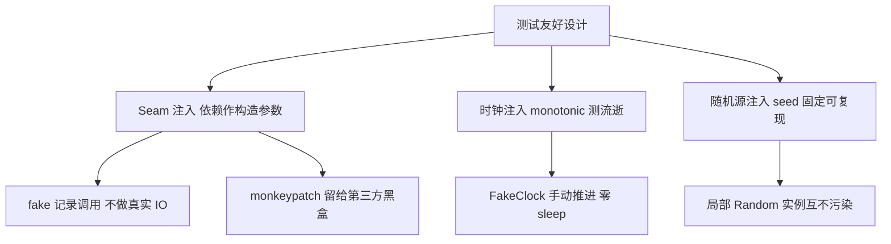

### Q1567 · 随机源注入:seed 可控与可复现抽样

> 难度:★★☆☆☆ | 标签:random, 可测试性, 可复现

**问**:抽样逻辑怎么做成可复现?为什么用局部 random.Random 而不是全局 random 模块?

**答**:随机依赖注入:函数签名加 rng 参数,默认 random.Random()(真随机),测试传 random.Random(seed)——同 seed 序列完全一致,断言可写死。用局部实例而非全局 random 模块的理由:① 全局状态会被任何库 set_seed 污染,复现性崩塌;② 全局 MT19937 被多线程共享,局部实例天然隔离;③ 不同子系统用独立实例,序列互不干扰。要点:① Random(seed) 的序列只承诺同版本可复现,跨 Python 版本不保证,要跨版本稳定用 hashlib 派生确定性序列;② rng = rng or random.Random() 的写法安全——Random 对象恒真值,无 Falsy 陷阱;③ 采样、抖动、洗牌全部走注入的 rng,不要在函数深处偷偷用全局 random。

```python
# file: code/01_语言核心与底层/q1567_random_injection.py
import random


def pick_winners(pool, k, rng=None):
    """rng 是接缝:默认真随机,测试注入带 seed 的实例。"""
    rng = rng or random.Random()
    return rng.sample(sorted(pool), k)


def jittered_backoff(attempt, base=0.1, rng=None):
    """退避抖动:注入 rng 才能确定性测试。"""
    rng = rng or random.Random()
    return base * (2 ** attempt) * rng.uniform(0.5, 1.5)


if __name__ == "__main__":
    users = ["u%03d" % i for i in range(20)]

    a = pick_winners(users, 3, rng=random.Random(42))
    b = pick_winners(users, 3, rng=random.Random(42))
    print("seeded twice identical:", a == b, a)

    c = pick_winners(users, 3, rng=random.Random(7))
    print("different seed differs:", a != c, c)

    # 局部实例互不污染:同一 seed 推进不同步数后序列错开
    rng_a = random.Random(1)
    rng_b = random.Random(1)
    for _ in range(5):
        rng_a.random()
    print("independent streams:", rng_a.random() != rng_b.random())

    delays = [round(jittered_backoff(i, rng=random.Random(0)), 4)
              for i in range(4)]
    print("backoff series:", delays)

    # 不写 seed 的默认行为:每次不同
    print("unseeded varies:", pick_winners(users, 3) != pick_winners(users, 3))
```

**追问**:1) seed 相同跨 Python 版本结果一致吗?——不承诺,random 序列的稳定性只在同版本内保证;要跨版本稳定就用 hashlib 派生的确定性「伪随机」。2) 可复现设计?——随机源作为依赖注入(random.Random 实例而不是全局 random);seed 写进测试元数据;抽样断言用容差而不是精确序列(版本升级不至于全线崩)。3) 派生确定性?——hashlib(seed).digest 切片成整数序列,跨版本跨平台稳定;加密语义用 secrets 而不是 random。4) 生产陷阱?——并发用全局 random 状态被污染(线程安全但序列交错);依赖 random 的「幂等」假设;测试 seed 固定后从不轮换,覆盖面假死。


