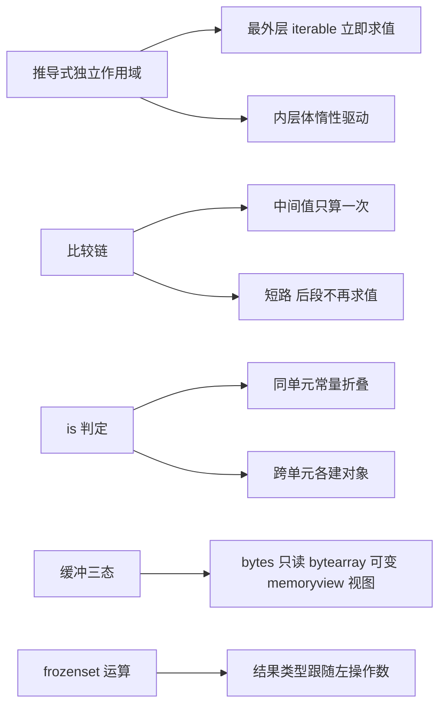

### Q1800 · frozenset 的运算分派:结果类型跟随左操作数

> 难度:★★☆☆☆ | 标签:集合, frozenset, 类型系统

**问**:`{1,2} - frozenset({2,3})` 与反过来写,结果类型一样吗?这背后是什么协议?

**答**:不一样:二元集合运算符按「左操作数类型优先」分派,set - frozenset 得 set,frozenset - set 得 frozenset,交并对称差同理——结果是类型层面的行为,不是实现巧合。三个推论:① 想锁死不可变语义,把 frozenset 写在左边或显式包一层;② 实例方法 f.union(任意可迭代) 总是返回 frozenset,参数类型不影响结果;③ 未绑定形式有严格的接收者检查——frozenset.intersection(set_obj, other) 会报「doesn't apply to a set object」,与 set 方法家族不同。frozenset 可哈希(Q536/Q1533),作 dict 键或集合元素时,运算结果的类型决定下游还能不能再进容器。

```python
# file: code/01_语言核心与底层/q1800_frozenset_dispatch.py
"""frozenset 的运算分派:结果类型跟随左操作数。"""


def result_type_follows_left():
    s, f = {1, 2, 3}, frozenset({2, 3, 4})
    return type(s - f).__name__, type(f - s).__name__


def method_semantics():
    f, b = frozenset({2, 3, 4}), {3, 4, 5}
    joined = f.union(b)              # 参数任意可迭代,返回 frozenset
    return joined, type(joined).__name__


def unbound_strict():
    s, f = {1, 2}, frozenset({2, 3})
    try:
        frozenset.intersection(s, f)  # 未绑定调用:接收者必须是 frozenset
    except TypeError as e:
        return str(e)[:34]
    return sorted(frozenset.intersection(f, s))


def reflected_keeps_left():
    s, f = {1, 2}, frozenset({2, 3})
    return type(s ^ f).__name__, type(f ^ s).__name__


def hashable_key():
    groups = {
        frozenset({"read", "write"}): "admin",
        frozenset({"read"}): "viewer",
    }
    return groups[frozenset({"read"})]


if __name__ == "__main__":
    rt = result_type_follows_left()
    print("s - f 的类型:", rt[0], "| f - s 的类型:", rt[1])
    print("f.union(set) 语义:", method_semantics())
    print("未绑定调用对接收者的类型检查:", unbound_strict())
    print("对称差结果类型:", reflected_keeps_left())
    print("frozenset 作 dict 键:", hashable_key())
```

**追问**:1) 为什么右操作数完全不影响结果类型?——双下方法分派先查左类型的 __sub__,命中即返回其定义的结果;右类型的反射方法只在左侧不认识自己时才介入(Q531)。2) 分派顺序的全貌?——左 __sub__ → 右 __rsub__ → TypeError;右是左的子类时右优先;NotImplemented 是「我不认识你」的信号,不是异常——抛错会中断整条分派链。3) 运算结果的类型契约?——frozenset - set 得 frozenset,set - frozenset 得 set,由左操作数的方法决定;这避免「结果类型不可预测」的混乱。4) 生产陷阱?——自定义类型漏反射方法导致 a+b 顺序敏感;在 __sub__ 里直接抛异常而不是返回 NotImplemented;与 numpy 混算时 __array_ufunc__ 抢分派权。


