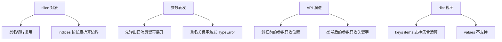

### Q1805 · dict 视图的集合运算:keys/items 视图的交并差

> 难度:★★★☆☆ | 标签:dict, 视图, 集合运算

**问**:dict.keys() 的返回值居然支持 `-` 和 `&`?哪些视图支持,哪些不支持,为什么?

**答**:keys 与 items 视图实现了集合协议,因为键唯一、items 元组可哈希,集合语义成立:ko - kn 是删除键,kn - ko 是新增键,ko & kn 配合逐键比值得出「值变化的键」,配置 diff 一行写完(Q1265 讲视图是动态窗口,本题讲集合运算)。values 视图不实现集合运算——值可重复且不必可哈希,减法语义无定义,hasattr(v, "__sub__") 为 False。items 视图交并差按 (key, value) 元组比较,适合找「完全相同的键值对」;要注意值里有 list 之类的不可哈希对象时 items 运算直接 TypeError。视图是活窗口:运算结果是基于当刻内容的快照集合,之后 dict 再变不影响已算出的结果。

```python
# file: code/01_语言核心与底层/q1805_dict_view_setops.py
"""dict 视图的集合运算:keys/items 视图的交并差。"""


def diff_views(old, new):
    ko, kn = old.keys(), new.keys()
    return {
        "added": sorted(kn - ko),
        "removed": sorted(ko - kn),
        "kept": sorted(ko & kn),
    }


def changed_values(old, new):
    return sorted(k for k in old.keys() & new.keys() if old[k] != new[k])


def values_not_setlike():
    return hasattr({"a": 1}.values(), "__sub__")


def items_setlike():
    a = {"x": 1, "y": 2}
    b = {"x": 1, "z": 3}
    return sorted(a.items() & b.items())     # 键值对元组的集合交集


if __name__ == "__main__":
    old = {"a": 1, "b": 2, "c": 3}
    new = {"b": 20, "c": 3, "d": 4}
    print("视图差集与交集:", diff_views(old, new))
    print("值变化的键:", changed_values(old, new))
    print("values 视图支持集合运算:", values_not_setlike())
    print("items 视图交集:", items_setlike())
```

**追问**:1) 视图集合运算的复杂度?——交并差按小集合逐成员查大集合哈希表,近似 O(min(len));items 运算要求值可哈希,值含 list 直接 TypeError。2) items 视图为什么按集合处理?——键唯一使 (k, v) 元组可判等,所以 ItemsView 注册为 Set;values 视图没有键可判等,只是 Collection(Q1265)——这是「能不能做集合运算」的判据。3) 与手写循环的对比?——视图运算零拷贝 + C 层哈希,远快于逐项循环;语义上等价于 set(d1.items()) & set(d2.items()) 但不物化。4) 生产陷阱?——值不可哈希时 items 运算崩,先想清楚要不要按值比较;把视图当静态集合缓存(动态窗口漂移);运算结果的「元素顺序」没有语义。


