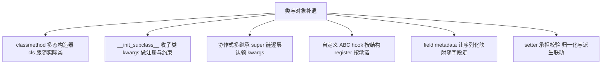

### Q1810 · dataclass field 的 metadata:让序列化映射随字段走

> 难度:★★★☆☆ | 标签:dataclass, metadata, 序列化

**问**:Q466 讲了 field 与 __post_init__,metadata 这个自由字典在工程里怎么用?

**答**:field(metadata={...}) 把任意只读映射挂到字段上,随 dataclasses.fields() 暴露,f.metadata 是 MappingProxyType 不可变。典型用法是把「字段级契约」内聚在模型上:wire 名映射、格式说明、是否外发(wire=None 表示私有字段),to_wire/from_wire 两个函数遍历 fields() 按 metadata 驱动,新增字段只改声明、不改序列化代码。三个注意点:① metadata 只放声明性小数据,别放可变对象或函数——要行为就挂类方法或协议;② default 与 metadata 无关,必填字段照样 field(metadata=...) 而不给 default;③ InitVar/ClassVar 不是真字段,fields() 不含它们(Q466/Q1273)。与 Annotated 的分工:静态检查器消费的标注走 Annotated,运行时框架消费的走 metadata,两者不冲突。

```python
# file: code/01_语言核心与底层/q1810_dc_metadata.py
"""dataclass field 的 metadata:驱动序列化映射。"""
from dataclasses import dataclass, fields, field


@dataclass
class User:
    id: int = field(metadata={"wire": "user_id", "fmt": "int"})
    name: str = field(metadata={"wire": "full_name", "fmt": "str"})
    note: str = field(default="", metadata={"wire": None})  # None 表示不外发


def to_wire(obj):
    out = {}
    for f in fields(obj):
        wire = f.metadata.get("wire")
        if wire:
            out[wire] = getattr(obj, f.name)
    return out


def from_wire(cls, raw):
    kwargs = {}
    for f in fields(cls):
        wire = f.metadata.get("wire")
        if wire and wire in raw:
            kwargs[f.name] = raw[wire]
    return cls(**kwargs)


if __name__ == "__main__":
    u = User(7, "Ada")
    print("字段到线上名的映射:",
          {f.name: f.metadata.get("wire") for f in fields(u)})
    w = to_wire(u)
    print("to_wire:", w)
    print("from_wire 回读:", from_wire(User, w))
    print("note 不外发:", "note" not in w)
```

**追问**:1) metadata 与 Annotated 怎么选?——静态检查器消费的走 Annotated,运行时框架消费的走 metadata;同一字段两边同时用也不冲突。2) metadata 的定位?——field(metadata={...}) 的 dict 随字段对象走,序列化/校验/文档框架按字段读取;这是 dataclass 的「字段级扩展点」,attrs 的等价物是 Attribute 元数据。3) 与 pydantic 的关系?——pydantic Field(...) 本质是把约束写进自己的模型体系;纯 dataclass 项目用 metadata + 自研消费层;混用两套口径是维护灾难。4) 生产陷阱?——metadata 键没有命名空间规范,多框架冲突;dict 可变,运行期被改无人察觉;把静态校验语义塞进 metadata(应该 Annotated 或 pydantic)。


