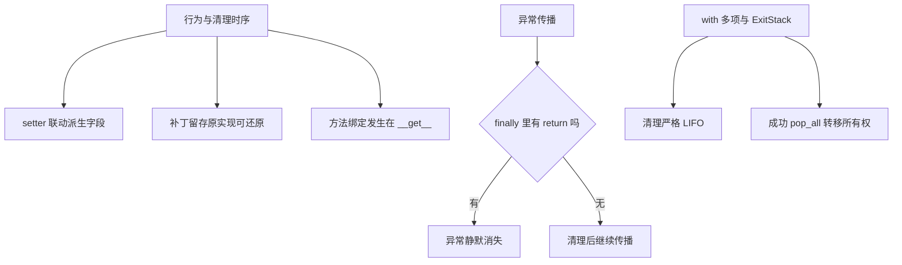

### Q1816 · ExitStack 的所有权转移:pop_all 与事务式交接

> 难度:★★★★☆ | 标签:ExitStack, 所有权, 事务

**问**:Q448 讲了 ExitStack 管动态资源,pop_all 的所有权转移在事务场景怎么用?

**答**:ExitStack 本质是「已进入资源的清理责任栈」,pop_all 把整栈回调搬到一个新栈、原栈变空——这是唯一安全的责任移交方式:成功路径 commit() 后临时文件归长期持有者,外层 with 退出时不再清理;失败路径异常沿外层栈展开,batch.stack.close 触发逐个 os.remove。事务模板三步:① 收集阶段把每个资源连同清理回调压进栈;② commit 调 pop_all 把责任移交持有对象;③ 失败什么都不做,让外层栈兜底。配套语义:close 幂等(空栈无害,Q1283),callback 注册的清理按逆序执行,与 with 多项的 LIFO 一致——「成功固定、失败全收」就是栈语义的直译。

```python
# file: code/01_语言核心与底层/q1816_exitstack_popall.py
"""ExitStack 的所有权转移:pop_all 与事务式交接。"""
import os
import tempfile
from contextlib import ExitStack


class Batch:
    """提交成功后长期持有临时文件;失败则逐个清理。"""

    def __init__(self):
        self.stack = ExitStack()
        self.keep = None

    def add_temp(self):
        fd, path = tempfile.mkstemp()
        os.close(fd)
        self.stack.callback(os.remove, path)
        return path

    def commit(self):
        # 成功:把清理责任原样移交,外层 with 退出时不再触碰这些文件
        self.keep = self.stack.pop_all()

    def close(self):
        if self.keep is not None:
            self.keep.close()      # 幂等:空栈 close 无害


def produce(commit=True):
    with ExitStack() as outer:
        batch = Batch()
        paths = [batch.add_temp() for _ in range(2)]
        outer.callback(batch.stack.close)   # 失败兜底:清空 batch 的栈
        if not commit:
            raise RuntimeError("中途失败")
        batch.commit()                      # 责任移交,batch.stack 已空
        return paths


if __name__ == "__main__":
    kept = produce(commit=True)
    print("提交后文件仍在:", [os.path.exists(p) for p in kept])
    for p in kept:
        if os.path.exists(p):
            os.remove(p)
    try:
        produce(commit=False)
    except RuntimeError as e:
        print("失败路径:", e, "→ 临时文件已随栈清理")
```

**追问**:1) pop_all 之后想撤销 commit 怎么办?——keep 栈再 close 就完成回滚;这正是「提交/回滚」两相齐全的实现基础。2) 事务式交接的全貌?——work 栈登记全部清理;成功路径 pop_all 移交 commit 栈并 close(执行清理);失败路径原栈 close(执行清理)——同一批动作按结果分流。3) 与直接 close 的差异?——pop_all 转移所有权,Q448;移交后旧栈清空,再 close 是 no-op;适合「资源由谁负责」动态决定的场景(连接池移交请求)。4) 生产陷阱?——移交后两条路径都 close 导致双重清理;忘记 close commit 栈(泄漏转移);异常发生在 pop_all 与 commit close 之间。


