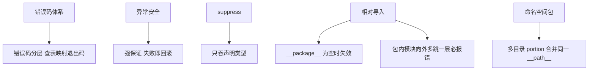

### Q1821 · 命名空间包的多路径合并:跨目录 portion 拼装

> 难度:★★★★☆ | 标签:命名空间包, PEP 420, 实战

**问**:Q416 讲了机制,两个不同目录的 myns 包怎么拼成同一个命名空间包?动手验证过吗?

**答**:PEP 420 的合并条件:sys.path 上多个目录各有同名目录且都**没有 __init__.py**,finder 把每个目录记为一个 portion,合成动态 __path__ 指向全部目录。demo 在临时目录造出 site_one/myns/alpha.py 与 site_two/myns/beta.py,PYTHONPATH 带上两个根后 import myns.alpha 与 myns.beta 同时成功——alpha 只在 site_one、beta 只在 site_two,portion 数为 2,myns.__file__ 为 None。实战要点:① portion 之间不能有同名模块,先到先得;② 一旦某目录写了 __init__.py,它变成常规包并遮蔽后续 portion,合并立即失效——这是「忘写 __init__.py 被静默当命名空间包」的镜像陷阱;③ 打包侧配 find_namespace_packages(Q416 已述),运行侧确认手段是看 __file__ 是否为 None 与 __path__ 的元素形态。

```python
# file: code/01_语言核心与底层/q1821_ns_merge.py
"""命名空间包的多路径合并:两个目录拼同一个包。"""
import os
import subprocess
import sys
import tempfile


def build(root):
    v1 = os.path.join(root, "site_one")
    v2 = os.path.join(root, "site_two")
    os.makedirs(os.path.join(v1, "myns"), exist_ok=True)   # 无 __init__.py
    os.makedirs(os.path.join(v2, "myns"), exist_ok=True)
    with open(os.path.join(v1, "myns", "alpha.py"), "w") as f:
        f.write("WHO = 'site_one'\n")
    with open(os.path.join(v2, "myns", "beta.py"), "w") as f:
        f.write("WHO = 'site_two'\n")
    return v1, v2


PROBE = (
    "import myns, myns.alpha, myns.beta;"
    "print('无 __init__ 的包 __file__ 是 None:', myns.__file__ is None);"
    "print('portion 数:', len(list(myns.__path__)));"
    "print('alpha 来自', myns.alpha.WHO, '| beta 来自', myns.beta.WHO)"
)


if __name__ == "__main__":
    with tempfile.TemporaryDirectory() as root:
        v1, v2 = build(root)
        env = dict(os.environ, PYTHONPATH=v1 + os.pathsep + v2,
                   PYTHONDONTWRITEBYTECODE="1")
        p = subprocess.run([sys.executable, "-c", PROBE],
                           capture_output=True, text=True, env=env)
        print(p.stdout.strip() or p.stderr.strip().splitlines()[-1])
```

**追问**:1) 两个 portion 定义了同名模块怎么办?——按 sys.path 顺序先到先得,后者被静默忽略,这是命名空间包最难排查的冲突形态,靠包名规划与 CI 体检预防。2) 多路径合并的机制?——命名空间包无 __init__.py,__path__ 是 NamespacePath 合并各 portion;pkgutil.iter_modules 能遍历全部 portion 的子模块;import 按路径序逐个找。3) 与普通包的共存?——某路径出现带 __init__ 的同名包,命名空间行为终止(部分合并);发行版拆分(如 namespace 分发)依赖这个机制。4) 生产陷阱?——两个发行版意外同名 portion,模块先到赢;CI 不检查重复包名;本地 editable 安装把命名空间包变普通包。


