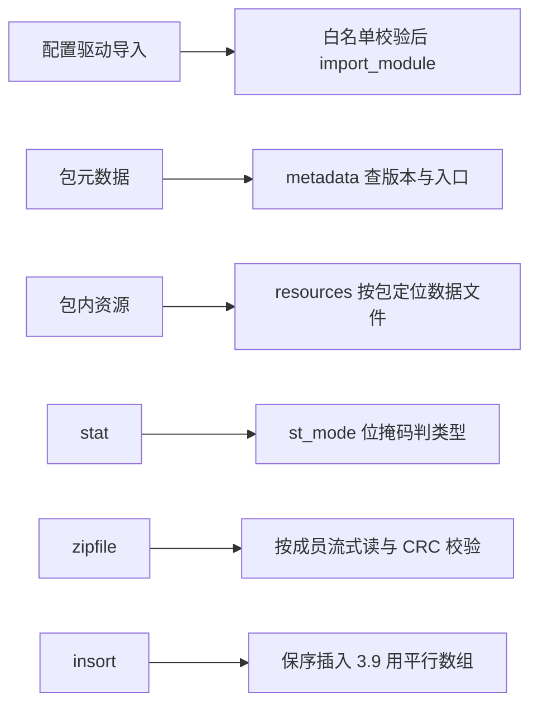

### Q1827 · bisect.insort:对象列表的有序维护与版本差异

> 难度:★★★☆☆ | 标签:bisect, insort, 数据结构

**问**:Q494 讲了 bisect 二分插入,insort 维护「对象列表」的有序在 3.9 上怎么写?

**答**:insort 二分找插入点后 list.insert:查找 O(log n) 但搬移 O(n),适合「读多写少、保持全序」的中等规模列表。3.9 没有 key= 参数(3.10 才加),对象有序用**平行数组**:keys 列表存排序键、events 列表存对象,add 时对 keys bisect_right 定位,两列表同位 insert——键重复时 bisect_right 把新事件排在同时间戳之后,符合追加语义。两条边界:① 插入的搬移是 O(n),高频追加换 heapq(Q495)或 append 后定期排序;② 平行数组必须同位增删,封装成类别暴露 add/get,别让两个裸列表外流。3.10+ 的 insort(rows, item, key=...) 可替代平行数组,demo 用 sys.version_info 守卫,本机 3.9.6 自动走平行数组分支。

```python
# file: code/01_语言核心与底层/q1827_insort_key.py
"""bisect.insort:对象列表的有序维护与版本差异。"""
import bisect
import sys


def plain_insort():
    xs = []
    for n in [5, 1, 9, 3, 7]:
        bisect.insort(xs, n)          # 二分找插入点,保持升序
    return xs


def object_list_39():
    # 3.9 没有 key= 参数:用「键列表 + 对象列表」平行数组维护对象有序
    keys, events = [], []

    def add(event):
        k = event["ts"]
        i = bisect.bisect_right(keys, k)
        keys.insert(i, k)
        events.insert(i, event)

    for ts in [30, 10, 20, 10]:
        add({"ts": ts, "tag": "e" + str(ts)})
    return events


if __name__ == "__main__":
    print("纯数字 insort:", plain_insort())
    events = object_list_39()
    print("对象有序(平行数组):", [e["ts"] for e in events])
    if sys.version_info >= (3, 10):
        rows = []
        for ts in [30, 10, 20]:
            bisect.insort(rows, {"ts": ts}, key=lambda e: e["ts"])
        print("3.10+ key= 版:", [r["ts"] for r in rows])
    else:
        print("3.10+ 的 key= 在本机",
              ".".join(map(str, sys.version_info[:3])), "不可用,已用平行数组替代")
```

**追问**:1) 为什么用 bisect_right 而不是 bisect_left?——right 插到相等键之后,保持「先来在前」的稳定语义;left 会插到相等键之前,时间戳相同时顺序错乱。2) 对象列表的 key 演进?——3.10+ insort 支持 key 参数;旧版本用 (sort_key, idx, item) 元组或包装类 __lt__;删除/查找同样用 bisect 定位区间。3) 维护的完整契约?——插入走 insort、查找走 bisect、删除先定位后 pop;任何 append/赋值破坏有序性都会让后续二分全错(Q494)。4) 生产陷阱?——key 函数开销大(每次插入都算);相等键的左右语义选错;并发修改无锁;把 bisect 当「排序替代」(它只维护已序结构)。


