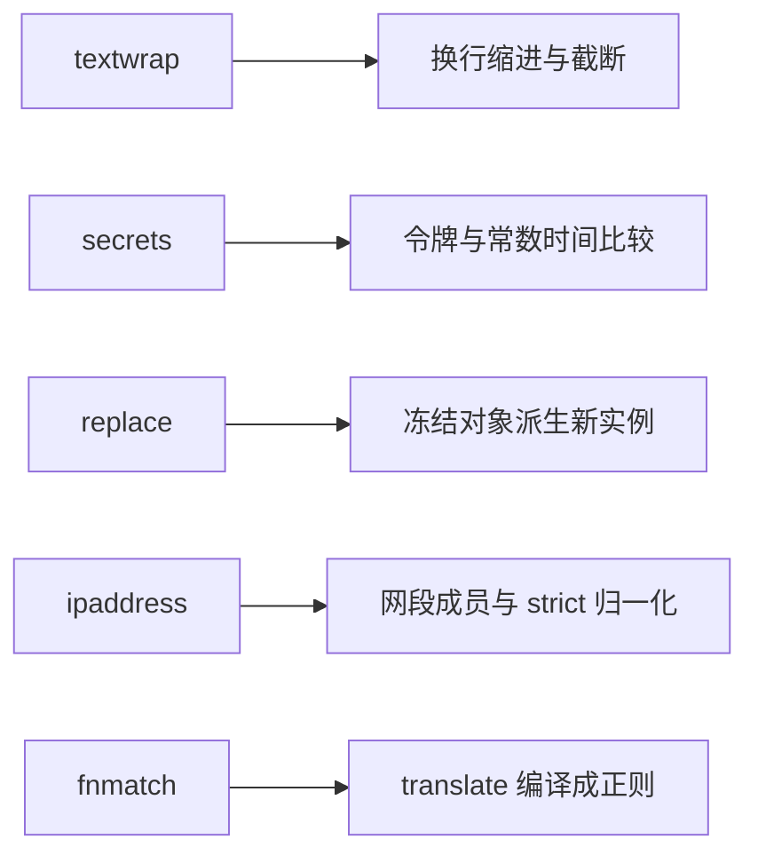

### Q1832 · fnmatch:shell 通配与正则的两套引擎

> 难度:★★☆☆☆ | 标签:fnmatch, 正则, 匹配

**问**:.txt 这类通配符匹配,fnmatch 与手写正则怎么选?大小写规则是什么?

**答**:fnmatch 是 shell glob 语义的 Python 实现:fnmatch(name, pattern) 先经 os.path.normcase 规范化再匹配——POSIX 上区分大小写、Windows 上不区分,想要确定行为用 fnmatchcase;translate(pattern) 把通配编译成等价正则源码(*、[...] 展开),re.compile 一次后高频复用,这是「通配写配置、正则跑热路径」的组合套路。工程要点:① 多模式过滤用 any(fnmatchcase(n, p) for p in patterns) 自行组合;② glob 模块管文件系统遍历,fnmatch 管纯字符串匹配,职责分层;③ 通配符语义里 * 不跨目录分隔符,与正则 .* 不同——translate 产物里能看到这条边界处理。

```python
# file: code/01_语言核心与底层/q1832_fnmatch_engine.py
"""fnmatch:shell 通配与正则的两套引擎。"""
import fnmatch
import re


def shell_match():
    names = ["log_2024.txt", "log_2025.txt", "data.csv", "notes.TXT"]
    # fnmatch 按 os.path.normcase 规范化;POSIX 上区分大小写,Windows 不区分
    return [n for n in names if fnmatch.fnmatch(n, "log_*.txt")]


def case_strict():
    names = ["notes.TXT", "notes.txt"]
    return [n for n in names if fnmatch.fnmatchcase(n, "*.txt")]


def translate_to_regex():
    source = fnmatch.translate("log_*.txt")   # 通配符 -> 正则源码
    rx = re.compile(source)
    return source[:34], bool(rx.match("log_2024.txt"))


def filter_any(names, patterns):
    return [n for n in names
            if any(fnmatch.fnmatchcase(n, p) for p in patterns)]


if __name__ == "__main__":
    print("shell 风格匹配:", shell_match())
    print("严格大小写:", case_strict())
    print("translate 产物:", translate_to_regex())
    print("多模式过滤:", filter_any(["a.csv", "b.TXT", "c.txt"], ["*.csv", "*.TXT"]))
```

**追问**:1) fnmatch.filter 与列表推导的性能差在哪?——单模式 filter 走 C 级循环更快;多模式先把每个 pattern translate+compile 成正则再 any,比逐次 fnmatchcase 快一个量级。2) 两套引擎的边界?——fnmatch 是 shell 通配(* ? [seq]),内部 translate 成正则;它不是 glob(不递归、不支持 **),递归找文件用 Path.glob/rglob;大小写:fnmatch 在大小写敏感系统区分、fnmatchcase 强制区分。3) 组合模式?——| 串联多个 translate 后的正则一次匹配;Path.match 与 fnmatch 语义有差(路径段)。4) 生产陷阱?——期望 ** 递归(不支持);大小写差异跨平台;循环内重复 fnmatch(pattern) 编译;把通配符当正则写(. 不转义)。


