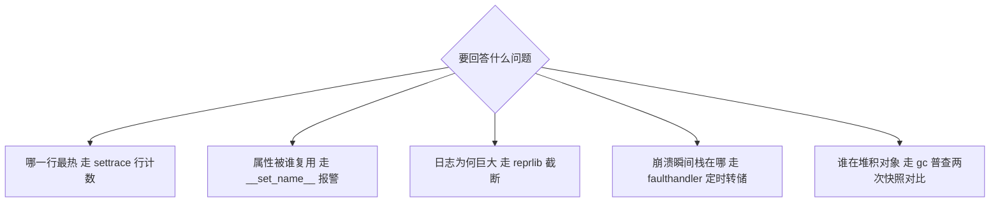

### Q1837 · gc.get_objects 普查:按类型统计定位泄漏

> 难度:★★★★☆ | 标签:gc, 内存, 泄漏排查

**问**:内存缓慢上涨,tracemalloc 之外,按对象类型做普查怎么定位谁在堆积?

**答**:gc.get_objects() 返回当前所有被 GC 跟踪的对象,按 type(o).__name__ 做 Counter 就是全堆普查:先 gc.collect() 排除待回收噪声取快照,复现疑似泄漏动作后再取一次,两次 Counter 相减,增量最大的类型即嫌疑对象——demo 里 500 个 dict 与内嵌 list 立刻现形。要点与边界:① 未被 GC 跟踪的类型(int/str 等原子对象)不在普查里,str 堆积要走 tracemalloc(Q506);② 普查自身开销大,只在诊断时跑,生产用低频采样;③ 定位到类型后用 gc.get_referrers 反查引用链,常见元凶是全局缓存没有淘汰策略(Q402 的阈值调优是容量侧,本题是内容侧)。

```python
# file: code/01_语言核心与底层/q1837_gc_census.py
"""gc.get_objects 普查:按类型统计定位堆积。"""
import gc
from collections import Counter


def census():
    return Counter(type(o).__name__ for o in gc.get_objects())


def growth(before, after, top=5):
    diff = Counter(after)
    diff.subtract(before)
    return diff.most_common(top)


if __name__ == "__main__":
    gc.collect()
    before = census()
    leak = []
    for i in range(500):
        leak.append({"i": i, "tags": [str(i)]})   # 制造 dict 与 list 堆积
    after = census()
    print("当前对象数 Top5:", before.most_common(5))
    top = growth(before, after)
    print("增量最大的类型:", top)
    dict_growth = dict(top).get("dict", 0)
    print("dict 增量 >= 500:", dict_growth >= 500)
    del leak
    gc.collect()
    print("清理后 dict 普查回落:", census()["dict"] <= after["dict"])
```

**追问**:1) 普查结果显示 dict 多了 50 万,下一步?——抽样找出共同特征,再用 gc.get_referrers 收敛到持有它们的容器,定位到该删没删或没有淘汰策略的那个全局缓存。2) 普查的完整流程?——gc.get_objects() 按 type Counter 统计 → 与基线快照对比 → 抽样对象找共性 → get_referrers 反查持有者 → 修复加回归测试。3) 局限与代价?——C 扩展对象不进 Python 堆(Q506);全量普查本身慢且要触发 GC;只看数量不看引用链会误判。4) 生产陷阱?——生产环境全量 get_objects 卡顿;缓存无淘汰策略是头号泄漏源;修完不写回归测试,复发。


