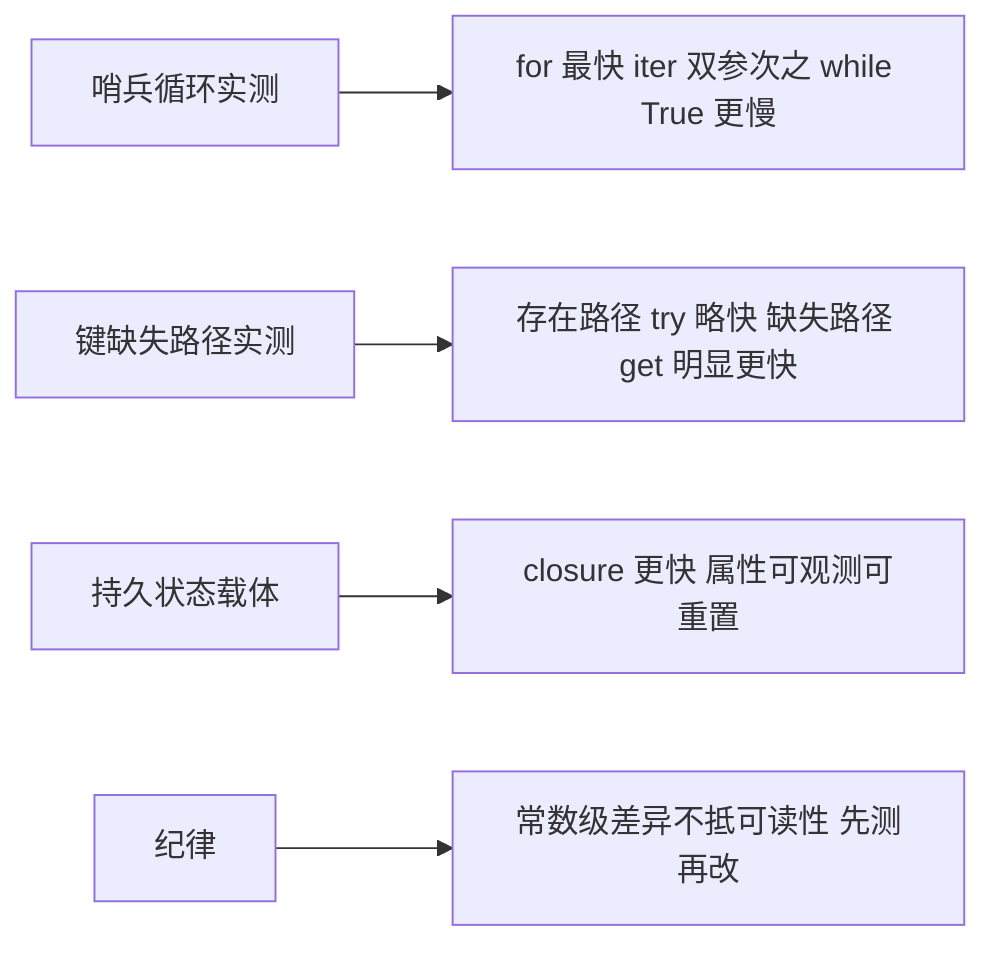

### Q1840 · 函数属性 vs 闭包变量:持久状态载体实测

> 难度:★★★☆☆ | 标签:闭包, 函数属性, 状态

**问**:给函数挂个计数器,函数属性 counter.n 和 nonlocal 闭包,实测与工程取舍?

**答**:10 万次调用实测:闭包版约 0.015s,函数属性版约 0.026s——闭包变量走 LOAD_DEREF 直读 cell,函数属性每次走全局名查找加属性访问,慢约七成(Q548 的名字查找层级差异直接兑现到这里)。取舍在可观测性:① 函数属性外部可见可重置(a.n = 0)、可内省、测试友好,状态是「公开的」;② 闭包状态封装彻底,外部只能经由行为观察,hasattr(b, "n") 为 False,防误改;③ 装饰器形态的状态(重试次数、缓存)习惯用闭包 + wraps(Q013/Q017)藏起来,需要运维侧调整的状态(限流阈值、开关)才显式暴露。与 Q1554 的 __defaults__ 运行时改写同属「函数即对象的持久状态」家族。

```python
# file: code/01_语言核心与底层/q1840_func_attr_closure.py
"""函数属性 vs 闭包变量:持久状态的两种载体实测。"""
import timeit


def make_with_attr():
    def counter():
        counter.n += 1          # 状态挂在函数对象上,全局名查找
        return counter.n
    counter.n = 0               # 外部可见、可重置、可内省
    return counter


def make_with_closure():
    n = 0

    def counter():
        nonlocal n              # 状态藏在 cell,快速局部访问
        n += 1
        return n
    return counter


def bench(fn, number=100000):
    return round(timeit.timeit(fn, number=number), 4)


if __name__ == "__main__":
    a, b = make_with_attr(), make_with_closure()
    print("attr 递增:", a(), a(), a())
    print("closure 递增:", b(), b(), b())
    a.n = 0                     # 函数属性:外部可直接重置
    print("重置 attr 后:", a())
    print("闭包状态不可直视:", not hasattr(b, "n"))
    print("attr 版耗时:", bench(a), "| closure 版耗时:", bench(b))
```

**追问**:1) 闭包状态想被测试重置怎么办?——提供显式 reset() 闭包或返回带方法的小对象,状态可测但仍然封装;别把 cell 状态硬拽出来。2) 两类载体的对比?——函数属性(__dict__ 挂状态)可测、可 introspect、可 monkeypatch;闭包 cell 封装最彻底但不可见不可测;多实例需求直接上类。3) 并发边界?——两者都是 check-then-act 竞态候选(Q446);要严格场景加锁或 lru_cache(maxsize=1);函数属性是「模块级可变状态」,多线程语义要想清。4) 生产陷阱?——闭包状态无法测试导致回归发现不了;函数属性被外部代码改写;状态重置接口缺失,测试间串扰。


