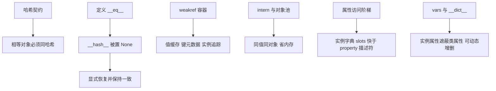

### Q2071 · vars 与实例 __dict__ 的动态增删

> 难度:★★★☆☆ | 标签:vars, __dict__, 属性查找

**问**:vars(obj) 返回什么?直接操作实例的 __dict__ 会有什么后果?

**答**:vars(obj) 就是 obj.__dict__ 本身——同一个字典对象的两种读法,通过任一视角增删条目,另一边立即可见。实例属性的查找链是「实例 __dict__ → 类 __dict__ → 父类链 → __getattr__ 兜底」,所以往实例里塞一个与类属性同名的条目就形成遮蔽,del 掉实例条目又重新露出类属性,这一遮一露正是很多「改了不生效」bug 的现场。类自身的 __dict__ 是 mappingproxy 只读视图,要改类属性得走类名字赋值而不是改它的 __dict__。动态改 __dict__ 适合做插件式字段注入与调试,业务代码里慎用:它会绕过 __slots__ 与 key 共享优化(Q1262),也让静态分析工具失明。

```python
# file: code/01_语言核心与底层/q2071_vars_dict.py
"""vars 与实例 __dict__:动态增删属性与查找链的遮蔽关系。"""


class Plugin:
    version = "1.0"              # 类属性:在类的 __dict__ 里

    def __init__(self, name):
        self.name = name         # 进实例 __dict__


if __name__ == "__main__":
    p = Plugin("scanner")
    print("vars(p):", vars(p))
    print("类的 __dict__ 是只读视图:", type(Plugin.__dict__).__name__)

    p.timeout = 3.0              # 动态添加实例属性
    vars(p)["retries"] = 2       # 两个视角是同一个字典
    print("动态添加后:", vars(p))

    print("遮蔽前读到类属性:", p.version)
    p.version = "9.9-beta"       # 实例条目遮蔽类属性
    print("遮蔽后:", p.version, "| 类属性未变:", Plugin.version)
    del p.version                # 删除实例条目,重新露出类属性
    print("删除实例属性后:", p.version)

    del p.retries                # del 名字等价于删 __dict__ 条目
    print("del 后 retries 还在吗:", "retries" in vars(p))
```

**追问**:1) vars(obj) 与 obj.__dict__ 是什么关系?——同一字典的两种读法,改任一侧另一侧同步;能给实例整体换一个 __dict__ 吗?——可以,等于一次性替换属性表,但会破坏 key 共享与 slots 约束,见 Q1262。2) 动态增删的代价?——新增属性可能让共享键表版本分裂,该实例退回独立 dict;vars() 返回的是本体字典不是拷贝,改它就是改对象。3) 适用场景?——vars(obj) 用于调试快照、ORM 风格的动态字段;有契约的类应显式声明属性或 slots。4) 生产陷阱?——把 __dict__ 当持久存储(动态属性无静态契约);整体换 __dict__ 让共享布局失效(Q1262);slots 类没有 __dict__,vars() 报 TypeError。


